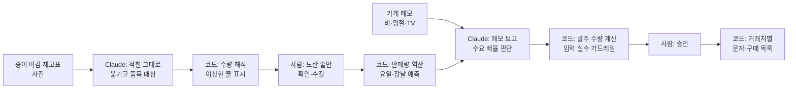
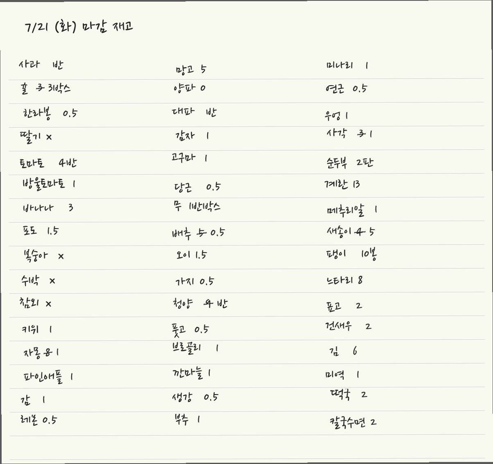

# fresh-stock-agent

청과 매장을 위한 AI 에이전트. 손으로 쓴 마감 재고표 사진을 읽어 재고를 기록하고, 가게 메모(날씨·명절·TV 방송)를 반영해 다음 날 발주를 추천하고, 거래처별 주문 문자를 만든다.

## 한눈에 보기

| | |
|---|---|
| 재고표 사진 인식 (합성 재고표 10장, 485줄) | 줄 정확도 97.9%, 틀린 줄 100%에 확인 표시, **표시 없이 틀린 값 0줄** |
| 발주 에이전트 (가상 매장, 추석 포함 40일) | 규칙 대비 품절 −29~39%, 이익 +5.5~8.2% |
| 입력 실수 가드레일 (가상 매장 90일) | 발주 입력 실수 19건 중 19건 차단, 오경보 0건 |
| 화면 | 모바일 웹: 재고표 사진 → 확인 → 발주 승인 → 거래처 문자 복사 |

모든 수치는 가상 매장과 합성 재고표 기준이며 실제 매장 성과가 아니다. 가정과 한계는 아래에 적었다.

## 배경

과일·야채 매장(취급 품목 60~90종, 직원 5~7명)을 1년 3개월 운영하며 겪은 문제에서 출발했다.

- 매일 마감 1시간 전부터 재고를 종이에 적고, 발주와 매출 계산에 2~3시간이 들었다.
- 포스기가 없어 품목별 판매량이 기록되지 않았다. 매출은 돈통 현금과 카드리더기 합계뿐이었다.
- 발주량은 어제 판매량을 보고 감으로 정했다. 가락시장이 일요일에 쉬어 토요일엔 두 배로 들여왔고, 5일장 날은 더 팔렸다.
- 버리는 물건은 없었다. 남은 물건은 상태가 나빠지면 떨이로 싸게 팔았다.
- 입력 실수 한 번(토마토 8박스 → 88박스)이 그대로 헐값 떨이로 이어졌다.

## 하루 흐름과 역할 분담



설계 원칙은 세 가지다.

- **현장 습관을 바꾸지 않는다.** 종이 재고표는 그대로 쓰고 사진 한 장으로 입력한다. 떨이로 나간 양도 따로 적지 않는다 (입고일과 품목별 정가 판매 일수로 추정한다).
- **숫자는 코드, 판단과 언어는 LLM.** Claude는 손글씨를 옮기고, 품목을 매칭하고, 메모를 읽어 "평소의 몇 배"를 판단한다. 수량 해석, 판매량 역산, 발주 수량, 이상치 검사, 문자 속 수량은 전부 코드가 한다.
- **사람이 확인하고 승인한다.** 확인이 필요한 칸만 표시하고, 최종 발주는 사람이 승인한다.

## 실행

```bash
uv sync
uv run fresh-stock serve --demo        # http://127.0.0.1:8000 모바일 웹 (가상 매장 기록 60일을 넣고 시작)
uv run pytest                          # 테스트 83개
```

화면의 "합성 재고표로 해보기"를 누르면 오늘 예상 재고로 손글씨 재고표를 만들어 Claude가 읽는다. 홈에서 가게 메모를 추가하면 발주 에이전트가 반영한다.

실험용 명령:

```bash
uv run fresh-stock compare --days 90                                        # 규칙 기반 발주 방식 비교 (LLM 없음)
uv run fresh-stock compare --policies seasonal,agent --start 2026-08-20 --days 40   # 발주 에이전트 비교
uv run fresh-stock eval-sheets --n 10 --days 60 --seed 7                    # 합성 재고표 인식 평가
uv run fresh-stock messages --date 2026-09-21 --start 2026-08-20 --llm      # 거래처별 발주 문자
uv run fresh-stock simulate --policy seasonal --out out/                    # 가상 매장 기록을 CSV로
```

### LLM 백엔드

| 백엔드 | 선택 | 인증 | 기본 모델 |
|---|---|---|---|
| Claude Code CLI (기본) | `--backend claude-code` | Claude Code 로그인 (API 키 불필요) | sonnet |
| Anthropic API | `--backend anthropic` 또는 `FRESH_STOCK_LLM=anthropic` | `ANTHROPIC_API_KEY` 또는 `ant auth login` | claude-opus-5 |

두 백엔드 모두 JSON 스키마로 구조화 출력을 받고 이미지를 넘길 수 있다. Claude Code 백엔드는 `claude -p --safe-mode --strict-mcp-config`로 사용자 설정·MCP 도구가 프롬프트에 섞이지 않게 해서 호출당 입력을 8.6만 토큰에서 수천 토큰(요청에 따라 약 1.5천~5천)으로 줄였다. API 백엔드는 claude-opus-5에서 안전 분류기가 요청을 거절하면 서버가 다른 모델로 다시 처리하도록 `fallbacks="default"`를 켠다. 호출마다 입력·출력·토큰·시간을 `out/*.jsonl`에 남긴다.

## 구성

| 모듈 | 역할 |
|---|---|
| `recognition.py` | 재고표 사진 인식. Claude가 옮기고, 코드가 수량 해석·확인 표시 |
| `agent.py` | 발주 에이전트. 판매 기록 조회 도구, 품목·분류·날짜별 수요 배율 제출 |
| `ordering.py` | 규칙 기반 발주(기존 방식, 요일·장날 보정), 입력 실수 가드레일 |
| `accounting.py` | 재고로 판매량 역산, 떨이 양 추정 |
| `messages.py` | 거래처별 문자(한 줄), 전화 메모, 가락시장 구매 목록 |
| `service.py`, `store.py`, `web.py` | 하루 업무 흐름, SQLite 저장, 모바일 웹 (FastAPI + Jinja) |
| `simulator.py`, `events.py` | 가상 매장: 요일·장날·신선도·떨이·품절, 비 예보·추석·TV 방송 |
| `sheets.py`, `sheet_eval.py` | 합성 손글씨 재고표 생성과 인식 평가 |
| `llm.py` | Claude Code CLI / Anthropic SDK 백엔드, 호출 기록 |
| `data/` | 품목 62종·거래처 6곳 (가정값), 사장님 경험 노트 |

## 결과

### 1. 재고표 사진 인식

실제 재고표 사진이 없어서, 시뮬레이터의 마감 재고를 한글 손글씨 폰트(Google Fonts, OFL)로 그린 합성 재고표로 평가한다. 줄임말(방토, 청양, 사각), `반`·`4반` 표기, 가끔 붙는 단위, 줄 긋고 고쳐 쓴 칸, 기울어짐, 흐림, JPEG 압축을 넣었다. 정답이 함께 만들어져 자동으로 채점한다.



코드가 붙이는 확인 표시: 품목을 못 찾음, 수량을 해석 못 함, 글씨가 애매함(모델 판단), 고쳐 쓴 칸, 단위에 안 맞는 수량, 어제 재고 + 입고보다 많음(불가능한 값), 예상 재고보다 크게 적음(`11봉`을 `1봉`으로 읽는 경우), 같은 품목이 두 번.

처음 보는 합성 재고표 10장(485줄), Claude Sonnet, 추론 강도 low:

| 지표 | 1차 | 2차 (적게 읽음 검사 추가) |
|---|---|---|
| 줄 정확도 (품목·수량 모두 맞음) | 97.3% | 97.9% |
| 틀린 줄 중 확인 표시가 붙은 비율 | 92.3% (13줄 중 12줄) | 100% (10줄 중 10줄) |
| **확인 표시 없이 틀린 값이 들어간 줄** | 2줄 | **0줄** |
| 맞았는데 확인 표시가 붙은 줄 | 5.9% | 10.5% |
| 한 장 읽는 시간 | 평균 22.5초 | 평균 22.7초 |

가장 중요한 지표는 "표시 없이 틀린 줄"이다. 표시된 줄은 사람이 고치지만, 표시가 없으면 그대로 발주에 쓰인다. **폰트 글씨는 실제 손글씨보다 깨끗하므로 이 수치는 파이프라인 검증용이지 실제 인식률이 아니다.** 실제 매장에서 쓰면 확인 화면에서 고친 기록(모델이 읽은 값과 사람이 확정한 값)이 DB에 쌓이고, 홈 화면에 실제 수정 비율로 보인다.

### 2. 발주 에이전트

규칙(요일·장날 보정)의 수요 예측을 출발점으로, 가게 메모가 있는 날에만 Claude가 메모·판매 기록·[매장 경험 노트](src/fresh_stock/data/store_knowledge.md)를 보고 **수요 배율**을 정한다. 발주 수량은 코드가 `예측 수요 × 배율 × 1.2 - 재고`로 계산하고, 배율은 0.2~4.0으로 자른다. LLM 호출이 실패하면 규칙 추천으로 발주한다.

추석이 들어간 40일(8/20~9/28), 두 가지 seed:

| | seed 42 규칙 | seed 42 에이전트 | seed 7 규칙 | seed 7 에이전트 |
|---|---|---|---|---|
| 품절로 놓친 매출 | 2,715만 원 | 1,928만 원 (−29%) | 2,983만 원 | 1,813만 원 (−39%) |
| 떨이 비중 (매입 원가 대비) | 9.0% | 9.5% | 8.6% | 8.8% |
| 이익 | 3,463만 원 | 3,654만 원 (+5.5%) | 3,610만 원 | 3,908만 원 (+8.2%) |

시뮬레이터의 명절 배율과 에이전트가 참고하는 경험 노트는 둘 다 사장님 경험에서 왔다. 따라서 이 비교는 "에이전트가 글로 된 경험을 발주에 제대로 옮기는가"를 확인한 것이다.

### 3. 규칙 기반 발주 (가상 매장 90일, LLM 없음)

| | 기존 방식 (전일 판매량 기준) | 요일·장날 보정 |
|---|---|---|
| 품절로 놓친 매출 | 9,822만 원 | 5,374만 원 |
| 떨이 비중 (매입 원가 대비) | 11.7% | 11.0% |
| 이익 | 5,855만 원 | 7,249만 원 |
| 입력 실수 / 가드레일로 막음 | 19 / 19 | 17 / 17 |

## 만들면서 바꾼 것

| 문제 | 원인 | 바꾼 것 | 결과 |
|---|---|---|---|
| 에이전트가 규칙과 차이 없음 | 추석 전 과일을 올리는 방향은 맞았지만 20~60%만 올림. 얼마나 올릴지 근거가 없었다 | 사장님 경험(장날 1.5배, 명절 3일 전~당일 2~3배 등)을 경험 노트로 제공 | 품절 −16% |
| 노트에 "2~3배"가 있어도 첫날 20%만 올림 | LLM에게 최종 수량을 직접 쓰게 했다 | LLM은 배율과 이유만, 수량은 코드가 계산 | 품절 −27%, 호출당 33초 → 12초 |
| 40일에 호출 40회, 약 35분 | 메모 없는 날에도 매번 호출, 추론 강도 기본값 | 메모 없는 날은 규칙 추천 그대로, 추론 강도 low | 호출 9회, 약 3분 |
| 명절 대량 발주에 오경보 24건 | 가드레일이 입력값을 과거 평균과 비교 | 입력값을 시스템 추천 수량과 비교 | 오경보 0건, 입력 실수는 전부 차단 |
| 손글씨 `0`을 `o`로 읽음 | 손글씨에서 흔한 혼동 | 수량 칸의 `o`·`ㅇ`은 0으로 해석 | 첫 3장 오류 9줄 중 5줄 해결 |
| `11봉`을 `1봉`으로 읽었는데 표시 없음 | 적게 읽은 값은 "불가능한 값" 검사에 안 걸림 | 예상 재고보다 크게 적으면 표시. 기준은 저장된 결과를 LLM 재호출 없이 다시 채점해 정함 | 표시 없이 틀린 줄 2 → 0, 맞은 줄 표시는 약 3.5%p 늘어남 |
| 폐기 칸 없이 발주가 부풀어 오름 | 떨이로 나간 양까지 판매로 잡혀 발주가 늘고 떨이가 느는 악순환 | 입고일과 정가 판매 일수로 떨이 양을 추정해 정가 수요에서 뺌 | 재고표에 칸을 추가하지 않고 해결 |
| 에이전트 요약과 실제 결과가 다름 | "생강 발주를 늘렸다"고 썼지만 재고가 충분해 수량은 그대로 | 발주 화면에 코드가 계산한 "실제로 수량이 바뀐 품목"을 함께 표시 | LLM이 쓴 문장만 믿지 않게 함 |

위 표의 앞 두 줄 수치는 두부를 사각·손·순두부로 나누기 전에 측정했다.

## 한계와 다음 단계

- **실제 손글씨 사진으로 평가하지 않았다.** 합성 재고표 정확도는 실제 인식률이 아니다. 실제 재고표 사진이 생기면 같은 평가에 넣는다.
- **가상 매장은 가정값이다.** 품목·가격·판매량·비 오는 날 감소 폭(0.6배)·추석 다음날(0.5배)·TV 효과(다음 날 3배)는 추정이다.
- **계절 변화를 모델링하지 않았다.** 계절에 따라 잘 나가는 야채가 달라지지만 시뮬레이터 품목 수요는 기간 내내 같다.
- 다음 단계: 실제 재고표 사진 평가, 확인 화면에서 고친 줄임말을 품목 별칭으로 학습, LLM 트레이싱(Langfuse), 배포와 PostgreSQL 전환.

## 기술

Python 3.12, uv, FastAPI, Jinja2, SQLite, Pillow, Anthropic Python SDK, Claude Code CLI, pytest (83개).
