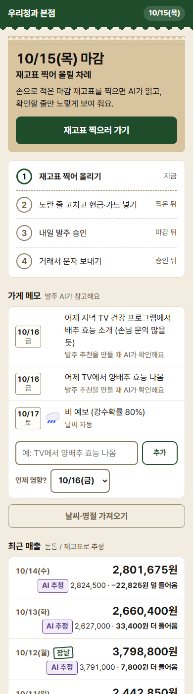
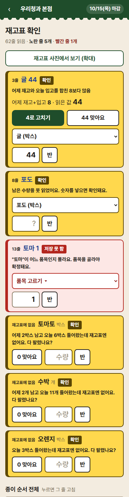
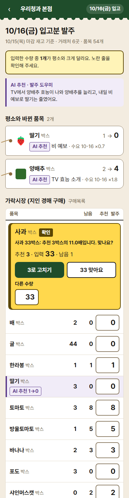
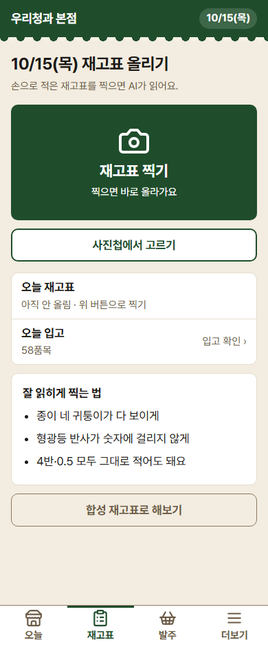
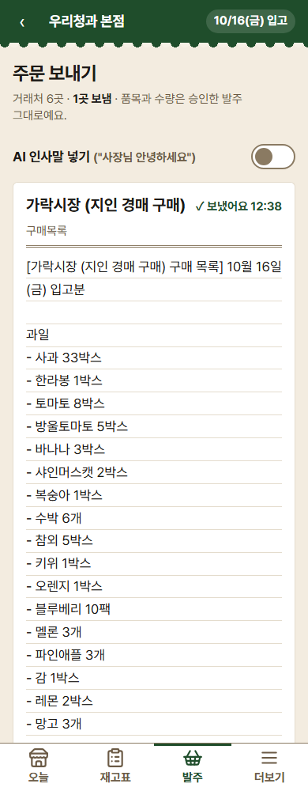
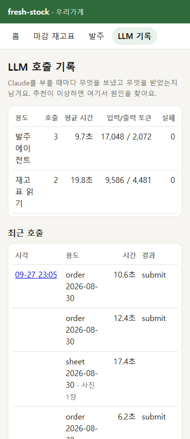
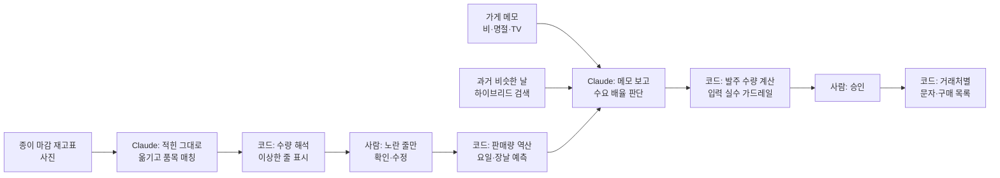
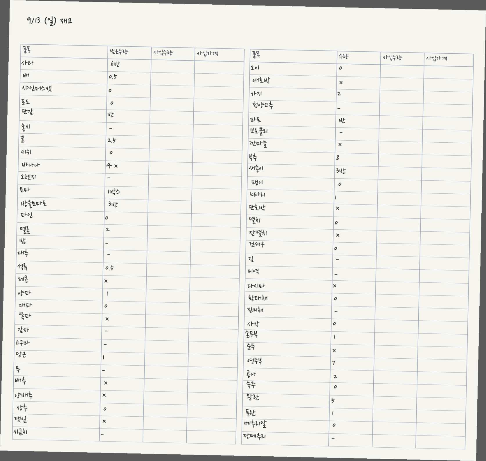
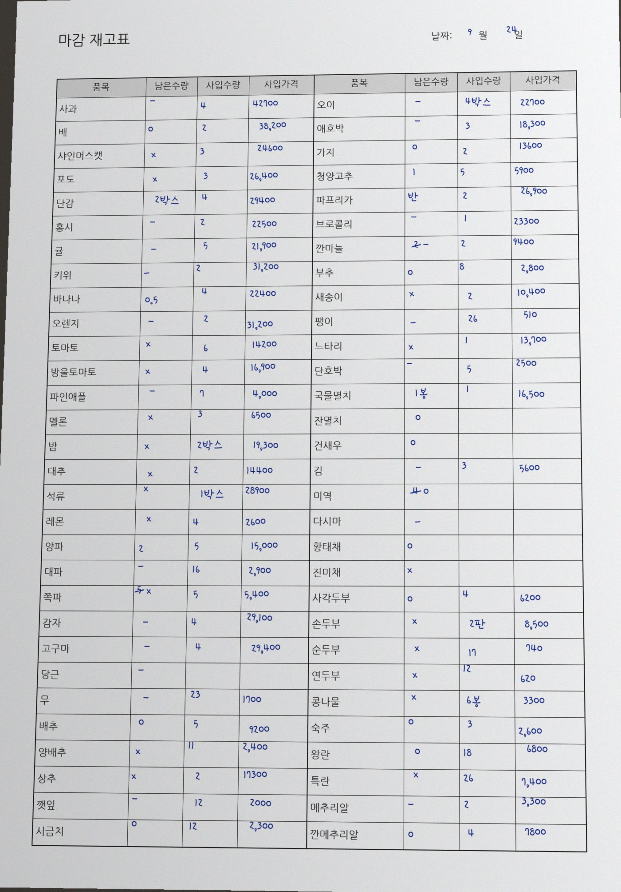
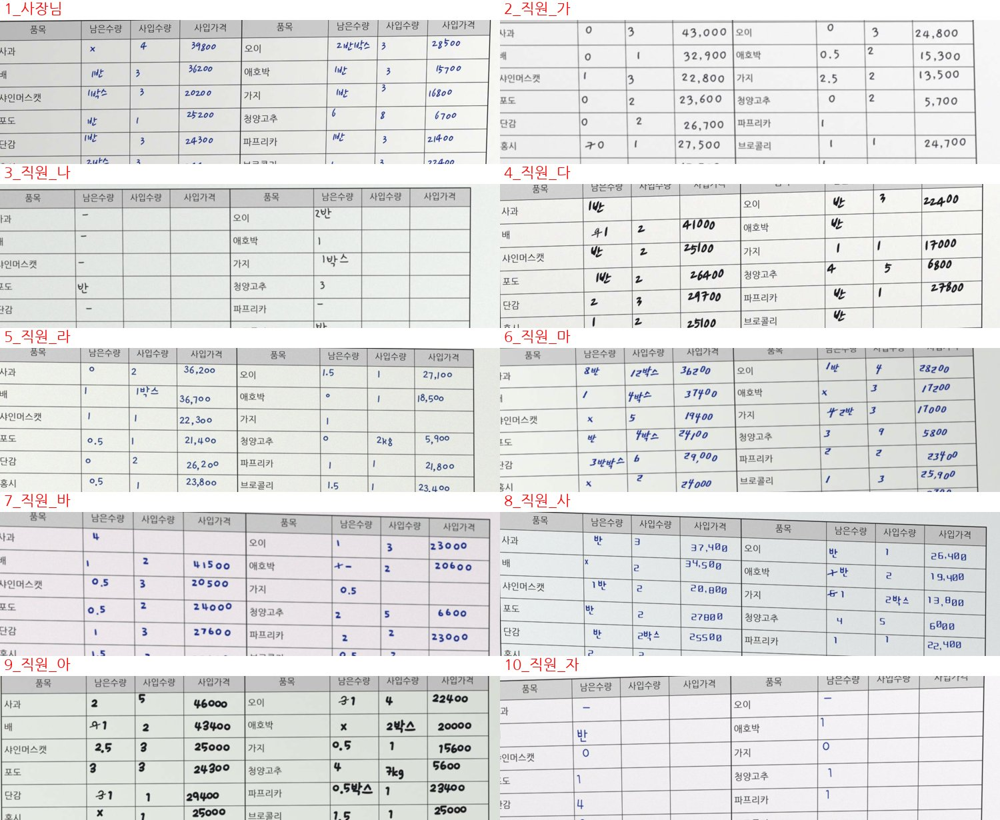

# fresh-stock-agent

청과 매장을 위한 AI 에이전트. 손으로 쓴 마감 재고표 사진을 읽어 재고를 기록하고, 가게 메모(날씨·명절·TV 방송)와 **과거 비슷한 날의 실제 판매 기록(RAG)**을 근거로 다음 날 발주를 추천하고, 거래처별 주문 문자를 만든다.

## 한눈에 보기

| | |
|---|---|
| 재고표 사진 인식 (합성 재고표 10장, 485줄) | 줄 정확도 97.9%, 틀린 줄 100%에 확인 표시, **표시 없이 틀린 값 0줄** |
| 발주 에이전트 (가상 매장, 추석 포함 40일) | 규칙 대비 품절 −29~39%, 이익 +5.5~8.2% |
| 과거 비슷한 날 검색 (RAG) | 사장님 경험 노트 없이 기록 검색만으로 규칙 대비 이익 +5.5~9%, 품절 −18~24% (사장님 감 수준) |
| 매장 고유 약어 기억 | 확인 화면에서 고친 기록으로 약어를 익혀, 표시 없이 틀린 줄 7 → 3, 불필요한 확인 표시 23% → 7% |
| 입력 실수 가드레일 (가상 매장 90일) | 발주 입력 실수 19건 중 19건 차단, 오경보 0건 |
| 화면 | 모바일 웹(청과 가게 디자인): 구글 로그인, 가게별 구분, 재고표 사진 → 노란 줄만 확인 → 발주 승인 → 거래처 문자·전화 보내기, AI 기록 |
| 화면 개편 (이전 화면과 같은 데이터로 비교) | 48px보다 작은 누르는 곳 366개 → 3개, 확인 안 한 노란 줄·빈 현금카드로 확정되던 것 차단, 사입 가격 표기 14가지 중 8 → 14가지 |
| 가게 설정 | 가게마다 품목·거래처·가격, 5일장 날짜·입고 없는 요일, 사장님 경험 노트를 화면에서 고친다 (CSV로 한꺼번에도) |
| 가게 메모 | 날씨·명절은 자동, 사장님이 적은 메모(TV 방송 등)는 발주 추천 때 AI가 웹 검색으로 확인해 반영 |
| MCP 서버 + 스킬 | Claude Code·Claude Desktop에서 말로 하루 업무 처리 (재고표 → 발주 추천 → 승인 전 확인 → 거래처 문자) |

모든 수치는 가상 매장과 합성 재고표 기준이며 실제 매장 성과가 아니다. 가정과 한계는 아래에 적었다.

요구사항은 [docs/PRD.md](docs/PRD.md), 설계는 [docs/SDD.md](docs/SDD.md), 데이터 구조는 [docs/ERD.md](docs/ERD.md)에 있다.

<p>



</p>
<p>



</p>

윗줄 왼쪽부터 홈(지금 할 일 봉투 카드, 오늘 순서, 가게 메모, 최근 매출), 재고표 확인(확인할 줄만 노란 카드로 맨 위, 품목을 모르는 줄은 빨간색, 재고표에 없는 품목은 [0 맞아요]), 발주(AI가 바꾼 품목은 가격표 카드, 평소와 크게 다른 입력은 [3로 고치기][33 맞아요]). 아랫줄은 재고표 올리기, 주문 보내기(거래처별 주문 쪽지, 보낸 거래처 표시), AI 기록(재고표 읽기 정확도, 익힌 줄임말, 호출 기록). 휴대폰 너비 390px, 데모 데이터.

## 배경

과일·야채 매장(취급 품목 60~90종, 직원 5~7명)을 1년 3개월 운영하며 겪은 문제에서 출발했다.

- 매일 마감 1시간 전부터 재고를 종이에 적고, 발주와 매출 계산에 2~3시간이 들었다.
- 포스기가 없어 품목별 판매량이 기록되지 않았다. 매출은 돈통 현금과 카드리더기 합계뿐이었다.
- 발주량은 어제 판매량을 보고 감으로 정했다. 가락시장이 일요일에 쉬어 토요일엔 두 배로 들여왔고, 5일장 날은 더 팔렸다.
- 버리는 물건은 없었다. 남은 물건은 상태가 나빠지면 떨이로 싸게 팔았다.
- 입력 실수 한 번(토마토 8박스 → 88박스)이 그대로 헐값 떨이로 이어졌다.

## 하루 흐름과 역할 분담



설계 원칙은 세 가지다.

- **현장 습관을 바꾸지 않는다.** 종이 재고표는 그대로 쓰고 사진 한 장으로 입력한다. 떨이로 나간 양도 따로 적지 않는다 (입고일과 품목별 정가 판매 일수로 추정한다).
- **숫자는 코드, 판단과 언어는 LLM.** Claude는 손글씨를 옮기고, 품목을 매칭하고, 메모를 읽어 "평소의 몇 배"를 판단한다. 수량 해석, 판매량 역산, 발주 수량, 이상치 검사, 문자 속 수량은 전부 코드가 한다.
- **사람이 확인하고 승인한다.** 확인이 필요한 칸만 표시하고, 최종 발주는 사람이 승인한다.

## 실행

```bash
uv sync
uv run fresh-stock serve --demo --dev-login   # 모바일 웹 (데모 가게에 기록 60일을 넣고 시작, 개발용 로그인). 8799번부터 빈 포트를 찾는다
uv run pytest                          # 테스트 (PostgreSQL 전용 10개는 FRESH_STOCK_TEST_PG가 있을 때만)
```

화면의 "합성 재고표로 해보기"를 누르면 오늘 예상 재고로 손글씨 재고표를 만들어 Claude가 읽는다. 홈에서 가게 메모를 추가하면 발주 에이전트가 반영하고, 발주 화면에 참고한 과거 기록이 나온다. 과거 기록 검색용 임베딩 모델(약 0.5GB)은 처음 쓸 때 `.cache/models`에 받는다. 받지 않으려면 `--no-rag`.

실험용 명령:

```bash
uv run fresh-stock compare --days 90                                        # 규칙 기반 발주 방식 비교 (LLM 없음)
uv run fresh-stock compare --policies seasonal,agent --start 2026-08-20 --days 40   # 발주 에이전트 비교
uv run fresh-stock compare --policies seasonal,owner,agent,agent-rag,agent-rag-only \
    --start 2025-08-01 --days 424 --switch 2026-08-20                       # 과거 기록 검색(RAG) 비교
uv run fresh-stock eval-retrieval                                           # 가게 메모 검색 방식 비교
uv run fresh-stock eval-sheets --n 10 --days 60 --seed 7                    # 합성 재고표 인식 평가
uv run fresh-stock eval-sheets --n 10 --days 60 --seed 11 --store-abbr --with-aliases   # 매장 약어 기억
uv run fresh-stock eval-sheets --layout store --read-purchases --n 5 --start 2026-09-01 --days 60 --seed 7   # 실제 가게 형식 (사입 칸)
uv run fresh-stock messages --date 2026-09-21 --start 2026-08-20 --llm      # 거래처별 발주 문자
uv run fresh-stock simulate --policy seasonal --out out/                    # 가상 매장 기록을 CSV로
```

### 휴대폰이나 다른 사람에게 보여 주기 (Tailscale)

내 PC에서 띄운 서버를 [Tailscale Funnel](https://tailscale.com/kb/1223/funnel)로 https 주소에 연결하면, 테일스케일이 없는 휴대폰이나 다른 사람도 주소만으로 들어온다.

```bash
uv run fresh-stock serve --demo --dev-login --port 8800
tailscale funnel --bg --https=8443 http://127.0.0.1:8800   # https://<기기 이름>.<tailnet>.ts.net:8443/
tailscale funnel --https=8443 off                          # 다 보여 줬으면 닫는다
```

- 개발용 로그인을 켠 채로 열면 주소를 아는 사람은 아무 이메일로나 들어와 데모 가게의 사장님이 된다. 잠깐 보여 줄 때만 쓰고, 오래 열어 둘 거면 구글 로그인을 설정하고 `--dev-login`을 뺀다.
- 들어온 사람이 재고표 읽기·발주 추천·메모 확인을 누르면 서버를 띄운 PC의 Claude 계정으로 AI가 돈다.
- 테일넷 안에서만 열려면 `funnel` 대신 `tailscale serve`를 쓴다.

### 저장소 (SQLite / Supabase)

기본은 SQLite 파일(`out/store.db`)이다. PostgreSQL(Supabase 등) 주소를 주면 같은 코드로 PostgreSQL을 쓴다. SQL은 두 DB에서 모두 도는 문법만 쓰고, 원격 DB에서는 연결 풀로 끊긴 연결을 다시 잇는다.

```bash
cp .env.example .env                  # .env에 FRESH_STOCK_DB=postgresql://... (Supabase 연결 문자열)
uv run fresh-stock copy-db out/store.db "postgresql://..."   # 지금까지 SQLite에 쌓인 데이터를 빈 DB로 옮김
uv run fresh-stock serve               # .env의 FRESH_STOCK_DB로 뜬다 (화면 출력에서 비밀번호는 가림)
```

PostgreSQL에서도 저장소 테스트를 돌릴 수 있다: `FRESH_STOCK_TEST_PG=postgresql://... uv run pytest`. 로컬 PostgreSQL 16으로 저장소 테스트와 웹 하루 흐름(재고표 읽기 → 확정 → 과거 기록 검색이 들어간 발주 → 승인 → 문자)을 확인했다.

### LLM 백엔드

| 백엔드 | 선택 | 인증 | 기본 모델 |
|---|---|---|---|
| Claude Code CLI (기본) | `--backend claude-code` | Claude Code 로그인 (API 키 불필요) | sonnet |
| Anthropic API | `--backend anthropic` 또는 `FRESH_STOCK_LLM=anthropic` | `ANTHROPIC_API_KEY` 또는 `ant auth login` | claude-opus-5 |

두 백엔드 모두 JSON 스키마로 구조화 출력을 받고 이미지를 넘길 수 있다. Claude Code 백엔드는 `claude -p --safe-mode --strict-mcp-config`로 사용자 설정·MCP 도구가 프롬프트에 섞이지 않게 해서 호출당 입력을 8.6만 토큰에서 수천 토큰(요청에 따라 약 1.5천~5천)으로 줄였다. API 백엔드는 claude-opus-5에서 안전 분류기가 요청을 거절하면 서버가 다른 모델로 다시 처리하도록 `fallbacks="default"`를 켠다. 호출마다 입력·출력·토큰·시간을 `out/*.jsonl`에 남긴다.

## 구성

| 모듈 | 역할 |
|---|---|
| `recognition.py` | 재고표 사진 인식. Claude가 옮기고, 코드가 수량 해석·확인 표시 |
| `agent.py` | 발주 에이전트. 판매 기록 조회·과거 기록 검색 도구, 품목·분류·날짜별 수요 배율 제출 |
| `auto_notes.py`, `research.py` | 날씨·명절 메모 자동 수집, 사장님 메모를 AI가 웹 검색으로 확인 |
| `memory.py` | 과거 비슷한 날 검색(RAG): 메모가 있던 날의 실제 판매 배율·품절 기록, BM25 + 임베딩 하이브리드 검색 |
| `ordering.py` | 규칙 기반 발주(기존 방식, 요일·장날 보정), 입력 실수 가드레일 |
| `accounting.py` | 재고로 판매량 역산, 떨이 양 추정 |
| `messages.py` | 거래처별 문자(한 줄), 전화 메모, 가락시장 구매 목록 |
| `service.py`, `store.py` | 하루 업무 흐름과 가게 설정, SQLite·PostgreSQL 저장(가게별) |
| `web.py`, `templates/`, `static/`, `visuals.py` | 구글 로그인과 모바일 웹 (FastAPI + Jinja), 화면 디자인(CSS·글꼴·그림), 품목 이름으로 그림 고르기 |
| `catalog.py` | 품목·거래처 목록: 기본 목록, 취급을 그만둔 품목(지난 기록용), CSV 내보내기·가져오기 |
| `simulator.py`, `events.py` | 가상 매장: 요일·장날·신선도·떨이·품절, 비 예보·추석·TV 방송 |
| `sheets.py`, `sheet_eval.py` | 합성 손글씨 재고표 생성과 인식 평가 |
| `mcp_server.py`, `runtime.py` | MCP 서버(도구, 가게 권한, 승인 안전장치), 웹·MCP 공통 서비스 구성 |
| `llm.py` | Claude Code CLI / Anthropic SDK 백엔드, 호출 기록 |
| `data/` | 기본 품목 64종·거래처 6곳 (가정값), 기본 경험 노트. 가게에서 고치기 전까지 쓴다 |

## 가게 메모

| 메모 | 가져오는 방법 | 반영 |
|---|---|---|
| 비 예보, 폭염 | Open-Meteo 예보 API (키 불필요). 지난 날짜는 그 시점 예보를 보관한 API | 발주 추천 때 자동으로 넣고, 새 예보가 오면 바꾼다 |
| 설·추석 대목, 연휴 | `holidays` 패키지의 한국 공휴일 (음력 계산) | 자동 |
| 사장님이 들은 이야기 ("어제 TV에서 양배추가 몸에 좋다고 나왔대") | 사장님이 메모로 적는다 | **발주 추천을 만들 때 AI가 웹 검색으로 확인**하고, 확인 여부·요약·관련 품목·출처를 메모와 함께 에이전트에게 준다 |

날씨·명절 문구는 에이전트와 과거 기록 검색이 쓰는 표현("비 예보 (강수확률 80%)", "추석 2일 전 (명절 대목)")에 맞춰서, 자동으로 들어온 메모로도 과거 비슷한 날이 검색된다. 가게 위치는 `.env`의 `FRESH_STOCK_LAT`, `FRESH_STOCK_LON` (기본 서울). 매일 예약 실행하려면 `uv run fresh-stock fetch-notes`.

**TV·건강 기사를 매일 뒤지지 않고 사장님 메모를 기준으로 조사하는 이유**: 처음에는 AI가 매일 최근 TV·건강 기사를 찾게 해 봤는데, TV 방송 내용은 공식 API가 없어서 잡히는 건 인터넷 건강 기사뿐이었고, 추론 강도 low에서는 아무것도 못 찾고 끝나기도 했다(medium에서 1~3분). 그래서 사장님이 손님이나 방송에서 들은 이야기를 메모하면, 그 메모를 AI가 확인하는 쪽으로 바꿨다. 조사는 따로 예약 작업을 두지 않고 저녁에 발주 추천을 만들 때(보통 밤 9~12시) 아직 확인하지 않은 메모만 동시에 한다. 확인하지 못한 내용은 짐작하지 않고 "AI가 확인하지 못함"으로 남기며, 조사가 실패해도 발주 추천은 그대로 나간다.

예: "어제 저녁 TV 건강 프로그램에서 브로콜리가 암 예방에 좋다고 나왔대" → 방송사·프로그램은 특정하지 못했다고 밝히고, 브로콜리 효능 기사 2건을 출처로 붙이고, 관련 품목을 브로콜리로 남겼다 (28초).

## 로그인과 가게 구분

- **구글 로그인**: 이메일이 확인된 구글 계정만 받는다. 세션은 서명된 쿠키에 30일 동안 남는다
- **가게**: 처음 로그인한 사람이 가게를 만들면 사장님이 되고, 가게 관리에서 직원의 구글 계정 이메일을 추가한다. 추가된 사람은 그 계정으로 로그인하면 바로 그 가게 화면이 열린다. 여러 가게에 속하면 로그인할 때 고른다
- **구분**: 재고·발주·메모·재고표·가게 설정·AI 호출 기록이 모두 가게별로 나뉘고, 모든 화면이 로그인과 가게 멤버인지를 확인한다. 멤버 추가·삭제는 사장님만 할 수 있고, 마지막 사장님은 뺄 수 없다
- **개발용 로그인**: PC에서 확인할 때 `--dev-login` (또는 `FRESH_STOCK_DEV_LOGIN=1`)을 주면 이메일만 넣어 로그인할 수 있다. 운영에서는 끈다

구글 로그인 설정: Google Cloud Console → API 및 서비스 → 사용자 인증 정보 → OAuth 클라이언트 ID(웹 애플리케이션)를 만들고, 승인된 리디렉션 URI에 `http://127.0.0.1:8799/auth/google`(배포하면 `https://도메인/auth/google`)을 넣은 뒤 `.env`에 `GOOGLE_CLIENT_ID`, `GOOGLE_CLIENT_SECRET`, `FRESH_STOCK_SECRET`을 넣는다.

## 가게 설정과 입고 확인

기본 품목·거래처·장날은 가상 매장 값이다. 실제 가게에서 쓰려면 **품목·설정** 화면(사장님만)에서 고친다.

- **품목**: 이름·분류·단위·거래처·판매가·매입가·하루 판매량·정가로 파는 기간. 하루 판매량은 판매 기록이 생기기 전 첫 발주 추천에만 쓴다. 하나라도 고치면 그 가게 목록이 DB에 저장되고, 그 전까지는 기본 목록을 쓴다
- **취급 그만두기**: 품목은 지우지 않는다. 지난 재고·입고 기록에 남아 있어 판매량을 역산할 때 필요해서, 재고표·발주·거래처 문자에서만 빼고 "다시 취급"으로 되돌릴 수 있다
- **새 품목의 첫 발주**: 판매 기록에는 그 품목이 들어오기 전 날들이 "판매 0"으로 남는다. 그대로 쓰면 추천이 계속 0이라 한 번도 들어오지 않아서, 처음 들어오기 전 날과 7일 넘게 계속 하나도 없던 날은 수요 기록에서 뺀다. 가상 매장 90일·424일 비교 결과는 바꾸기 전과 같다
- **거래처**: 이름과 주문 방식(구매목록·문자·전화). 품목이 남아 있는 거래처는 지울 수 없다
- **장날·입고 요일**: 5일장 날짜(1·6일 ~ 5·10일, 없음)와 입고가 없는 요일. 입고 요일을 바꾸면 승인 전 발주 추천은 지우고 다시 만든다 (품목이 늘거나 빠져도 같다)
- **경험 노트**: 발주 에이전트가 메모를 보고 배율을 정할 때 참고하는 사장님 경험. 비우면 경험 노트 없이 판단한다
- **재고표 형식**: `품목 · 남은 수량`(기본) 또는 실제 가게 종이처럼 `품목 · 남은 수량 · 사입 수량 · 사입 가격` 두 묶음. 사입 칸이 있으면 아래 입고 확인을 재고표로 대신한다
- **CSV로 한꺼번에**: 품목이 수십 개면 `export-catalog`로 뽑아 엑셀에서 고치고 `import-catalog`로 넣는다. CSV에서 빠진 품목은 취급을 그만둔 품목으로 남는다

```bash
uv run fresh-stock export-catalog --store 1 --out out/catalog      # items.csv, suppliers.csv
uv run fresh-stock import-catalog --store 1 out/catalog/items.csv out/catalog/suppliers.csv
```

**입고 확인**: 발주를 승인하면 그 수량이 그대로 다음 날 입고로 기록된다. 거래처가 덜 보냈거나, 시장에 물건이 없었거나, 더 사 왔으면 재고표 화면의 "오늘 입고"(또는 더보기 → 입고 확인)에서 다르게 온 품목만 실제 들어온 양으로 고친다. 판매량을 "어제 재고 + 입고 − 오늘 재고"로 역산하므로 입고가 틀리면 판매량과 다음 발주가 같이 틀린다. 그날 재고표를 확정하기 전까지만 고칠 수 있다.

**사입 칸이 있는 재고표**: 사입 수량·가격 칸은 그날 실제로 들어온 양과 산 가격이다. AI가 사입 칸까지 읽고, 확인 화면에서 줄마다 사입 수량·가격을 고칠 수 있으며, 확정하면 승인한 발주 수량 대신 사입 칸으로 그날 입고를 기록하고 사입 가격을 남긴다 (빈 칸은 안 들어온 것). 이때 "불가능한 값" 검사도 발주 수량이 아니라 "어제 재고 + 사입 수량"으로 한다. 주문했는데 사입 칸이 비었거나 사입 가격이 최근 사입가(없으면 품목의 매입가)와 2.5배 넘게 다르면 확인 표시를 붙인다. 홈의 매출 표에 그날 사입 금액(사입 수량 × 사입 가격)이 함께 나온다. 이 형식에서는 따로 입고를 고치는 화면·도구를 쓰지 않는다.

## 화면 디자인

마감 뒤 지친 상태로 휴대폰 한 손에 쓰는 화면이라, 색은 뜻이 하나씩만 있게 정했다 ([PRD 8.2](docs/PRD.md#82-디자인-규칙)).

| 색 | 뜻 | 쓰는 곳 |
|---|---|---|
| 노랑 (가격표) | 확인 필요 | 재고표의 노란 줄, 평소와 크게 다른 발주 수량. 맞으면 [맞아요], 아니면 숫자를 고치면 확인된다 |
| 빨강 | 이대로는 저장 못 함 | 어느 품목인지 모르는 줄. 품목을 골라야 확정 버튼이 나온다 |
| 보라 | AI가 판단한 것 | "AI 추천·AI 추정·AI 검색" 글자칩과 함께. 색만으로 말하지 않는다 |
| 초록 (잎) | 가게 간판·누르는 버튼·확인함 | |

- 홈 맨 위 **봉투 카드**에 지금 할 일 하나와 버튼 하나 (재고표 찍기 → 노란 줄 고치기 → 발주 확인 → 문자 보내기)
- 수량 칸은 정수 + [반] 칩 (4반 = 4.5), 금액 칸은 쉼표가 저절로 붙는다. 누르는 곳은 48px 이상, 아래 고정 버튼 56px
- 재고표 확인은 노란·빨간 줄과 "재고표에 없는 품목"(어제 재고가 남았는데 안 적힌 품목, [0 맞아요])을 맨 위 카드로, 나머지는 종이 순서 그대로 아래에 두고 누르면 그 줄을 고친다. 남은 노란 줄 수가 아래 막대에 보이고, 다 확인해야 확정 버튼이 나온다 (서버도 같은 규칙으로 막는다)
- 끝자리를 두 번 읽은 것 같은 값(88)에는 [8로 고치기]를 내준다 (고친 값도 가능한 양을 넘으면 내지 않는다). 빨간 줄의 품목 고르기 맨 위에는 적힌 이름과 비슷한 품목을 2~3개 보여 준다 (자모로 비교해 `굴` → 귤). 노란 줄이 7개 넘는 날은 화면이 온통 노랗지 않게 카드 바탕만 옅게 한다
- 거래처 문자는 주문 쪽지 모양. 거래처 전화번호를 넣어 두면 [문자 보내기]·[전화 걸기]가 바로 열리고, 누른 거래처는 "보냈어요 시각"으로 남는다
- 품목·설정에서 인쇄용 빈 재고표(품목 이름이 찍힌 두 묶음 표)를 받을 수 있다

## MCP 서버와 스킬

웹 화면 없이도 Claude Code나 Claude Desktop에서 말로 가게 업무를 볼 수 있다.

- **MCP 서버** (`fresh-stock mcp`, `src/fresh_stock/mcp_server.py`): 오늘 할 일, 메모 추가·조회·AI 확인, 입고 확인·수정, 재고표 사진 읽기·확정, 발주 추천, 발주 승인, 거래처 문자, 매출, 품목 목록, 쉬는 날 건너뛰기를 도구로 공개한다. `FRESH_STOCK_EMAIL`이 멤버인 가게만 다룬다 (웹과 같은 규칙)
- **승인 안전장치**: `approve_order`는 사용자 승인 표시(`user_confirmed`)가 없으면 거절하고, 입력 실수 가드레일이 경고하면 승인하지 않고 경고를 돌려준다. 재고 확정(`confirm_sheet`)은 읽은 줄을 그대로 쓰고 사람이 확인한 줄만 받으며, 확인 표시된 줄을 확인받지 않으면 저장하지 않는다. 수량은 모두 코드가 계산한다
- **스킬** (`.claude/skills/fresh-stock-store/SKILL.md`): 하루 업무 순서, 확인 표시된 줄만 사람에게 묻기, 발주 수량을 지어내지 않기, 승인 전에 보여주고 묻기, 확인 못 한 메모를 부풀리지 않기를 이유와 함께 적었다

연결: 이 폴더를 Claude Code로 열면 `.mcp.json`의 fresh-stock 서버와 스킬이 잡힌다. `.env`에 `FRESH_STOCK_EMAIL`(가게 멤버 이메일)과 `FRESH_STOCK_DB`를 넣는다. Claude Desktop은 설정의 MCP 서버에 `uv --directory <이 폴더> run fresh-stock mcp`를 추가한다.

실제 Claude Code(Sonnet)에 붙여 확인한 것:

| 요청 | 결과 |
|---|---|
| "오늘 할 일 알려줘. 손님이 어제 TV에 브로콜리가 암 예방에 좋다고 나왔대, 메모해 둬" | 할 일 확인 후 영향받을 날(다음 날)로 메모하고 "지금 AI로 확인할까요?" (31초) |
| "마감했어. 재고표 사진은 …jpg, 현금 50만 카드 90만, 발주 추천까지 보여줘" | 사진 읽기 → 확인 표시 3줄 반영 → 확정 → 메모 AI 확인(둘 다 "방송 확인 못 함"으로 전달) → 추천을 보여주고 **"이대로 승인할까?"에서 멈춤** (2분, DB에서 미승인 확인) |
| "승인할게. 근데 토마토만 88박스로 바꿔서" | 승인 도구를 부르기 전에 "추천 0박스·재고 5박스인데 88이 맞아, 8을 잘못 말한 거야?"라고 되물음 (미승인 유지) |

## 결과

### 1. 재고표 사진 인식

실제 재고표 사진이 없어서, 시뮬레이터의 마감 재고를 한글 손글씨 폰트(Google Fonts, OFL)로 그린 합성 재고표로 평가한다. 줄임말(방토, 청양, 사각), `반`·`4반` 표기, 가끔 붙는 단위, 줄 긋고 고쳐 쓴 칸, 기울어짐, 흐림, JPEG 압축을 넣었다. 정답이 함께 만들어져 자동으로 채점한다.


코드가 붙이는 확인 표시: 품목을 못 찾음, 수량을 해석 못 함, 글씨가 애매함(모델 판단), 고쳐 쓴 칸, 단위에 안 맞는 수량, 어제 재고 + 입고보다 많음(불가능한 값), 예상 재고보다 크게 적음(`11봉`을 `1봉`으로 읽는 경우), 같은 품목이 두 번.

처음 보는 합성 재고표 10장(485줄), Claude Sonnet, 추론 강도 low:

| 지표 | 1차 | 2차 (적게 읽음 검사 추가) |
|---|---|---|
| 줄 정확도 (품목·수량 모두 맞음) | 97.3% | 97.9% |
| 틀린 줄 중 확인 표시가 붙은 비율 | 92.3% (13줄 중 12줄) | 100% (10줄 중 10줄) |
| **확인 표시 없이 틀린 값이 들어간 줄** | 2줄 | **0줄** |
| 맞았는데 확인 표시가 붙은 줄 | 5.9% | 10.5% |
| 한 장 읽는 시간 | 평균 22.5초 | 평균 22.7초 |

가장 중요한 지표는 "표시 없이 틀린 줄"이다. 표시된 줄은 사람이 고치지만, 표시가 없으면 그대로 발주에 쓰인다. **폰트 글씨는 실제 손글씨보다 깨끗하므로 이 수치는 파이프라인 검증용이지 실제 인식률이 아니다.** 실제 매장에서 쓰면 확인 화면에서 고친 기록(모델이 읽은 값과 사람이 확정한 값)이 DB에 쌓이고, AI 기록 화면에 실제 수정 비율로 보인다.

**매장 약어 기억.** 확인 화면에서 사람이 확정한 "적힌 이름 → 품목"으로 이 매장의 약어 사전을 만들어, 다음 재고표부터 Claude에게 알려주고 결과도 코드로 대조한다 (약어와 다르게 매칭하면 확인 표시). 흔한 줄임말(방토, 청양)은 Claude가 원래 잘 알아들어서 효과가 없었다. 효과가 있는 건 그 가게만 아는 한 글자 약어다 (`양` = 양파? 양배추?, `사` = 사과? 사각두부?). 그런 약어 12개를 넣은 합성 재고표 10장:

| | 약어 기억 없음 | 약어 기억 있음 |
|---|---|---|
| 줄 정확도 | 96.9% | 98.1% |
| 표시 없이 틀린 줄 | 7 | 3 |
| 맞았는데 확인 표시가 붙은 줄 | 23.4% | 6.9% |

**실제 가게 재고표 형식.** 실제 종이 재고표는 줄마다 `품목 | 남은 수량 | 사입 수량 | 사입 가격` 네 칸이 왼쪽(A~D)·오른쪽(E~H) 두 묶음이고, 30줄이 과일·야채·건어물·두부·계란(왕란·특란·메추리알·깐메추리알)으로 꽉 찬다. 이 형식에 맞춘 예시 가게 목록 60품목(`data/sample_store/`, 사입 가격은 2026년 도매 시세를 대충 맞춘 값)으로 합성 재고표를 만들었다. 사입 가격은 날마다 평소 매입가에서 ±15% 오르내리고, `42000`·`42,000` 두 가지로 적는다.



같은 재고표 5장(300줄), Claude Sonnet, 추론 강도 low:

| | 지금 읽기 (품목·남은 수량만) | 지금 읽기 + 0·- 표기 수정 | 사입 칸까지 읽기 | 엑셀 인쇄 + 손글씨, 사진 (사입 칸까지) |
|---|---|---|---|---|
| 줄 정확도 (남은 수량) | 86.0% | 99.7% | 99.7% | 99.7% |
| 표시 없이 틀린 줄 | 0 | 0 | 0 | 0 |
| 맞았는데 확인 표시가 붙은 줄 | 6.6% | 7.0% | 7.0% | 8.7% |
| 사입 수량·가격 정확도 | - | - | 100% (300줄) | 100% (300줄) |
| 한 장 읽는 시간 | 평균 17.4초 | (같은 응답으로 다시 채점) | 평균 22.1초 | 평균 21.8초 |

**엑셀 인쇄 양식에 손으로 적은 사진.** 실제로는 엑셀로 만든 표를 인쇄해 숫자만 손으로 적는다. 그래서 칸 선·회색 머리글·품목 이름은 인쇄 글꼴(나눔고딕)로, 남은 수량·사입 수량·사입 가격·날짜는 손글씨로 칸보다 크거나 비뚤게(칸 선에 걸치기도 함) 그리고, 휴대폰으로 찍은 것처럼 원근으로 기울이고 한쪽에 그림자·잡음·흐림을 넣었다 (`--layout excel`). 위 표 마지막 열이 그 결과다. 틀린 1줄은 줄 긋고 옆에 고쳐 쓴 `반`을 지운 숫자까지 붙여 `7반`으로 읽은 줄로, "글씨가 애매함"과 "어제 재고 + 입고보다 많음" 표시가 붙었다. 맞았는데 표시된 줄은 대부분 고쳐 쓴 칸(일부러 표시하는 칸)이다.



**손글씨가 다른 10명.** 손글씨는 사람마다 달라서, 글씨체가 다른 10명(Google Fonts의 한글 손글씨 폰트 10종)에게 기울기·글자마다 흔들림·펜 누르는 힘과 적는 버릇(재고 0을 `x`·`-`·`0`·`ㅇ` 중 무엇으로 쓰는지, 반 박스를 `4반`·`4.5` 중 무엇으로 쓰는지, 가격에 쉼표를 찍는지, 수량 뒤에 단위를 붙이는지)을 따로 주고, 사람마다 다른 날 2장씩 엑셀 양식 재고표를 적게 했다 (`--writers`).



| 쓰는 사람 | 글씨체 | 버릇 | 줄 정확도 | 표시 없이 틀린 줄 | 사입 칸 |
|---|---|---|---|---|---|
| 1 | 나눔손글씨 펜 | 0은 x, 4반, 쉼표 없음 | 100% | 0 | 100% |
| 2 | 개구 | 0은 0, 4.5, 쉼표 | 100% | 0 | 100% |
| 3 | 하이멜로디 | 0은 -, 4반, 흔들림 | 98.3% | 0 | 100% |
| 4 | 나눔손글씨 붓 | 0은 x·-, 진한 획, 기울임 | 100% | 0 | 100% |
| 5 | 감자꽃 | 0은 ㅇ·0, 4.5, 쉼표 | 100% | 0 | 100% |
| 6 | 동해독도 | 0은 x, 많이 기울고 흔들림 | 100% | 0 | 100% |
| 7 | 독도 | 0은 -, 4.5, 왼쪽으로 기울임 | 100% | 0 | 100% |
| 8 | 귀여운 | 0은 0·x, 4반, 흔들림 | 99.2% | 0 | 100% |
| 9 | 싱글데이 | 0은 x, 4.5, 진한 획 | 99.2% | 0 | 100% |
| 10 | 푸어스토리 | 0은 -·0, 4반, 쉼표 | 100% | 0 | 100% |
| **전체 (20장, 1,200줄)** | | | **99.7%** | **0** | **100%** |

틀린 4줄은 모두 줄 긋고 옆에 고쳐 쓴 칸이었고(지운 숫자까지 붙여 읽음), 4줄 모두 확인 표시가 붙었다. 맞았는데 표시된 줄은 6.6%(대부분 고쳐 쓴 칸), 한 장 평균 21.7초. 폰트 10종은 실제 사람 글씨보다 여전히 깨끗하므로, 실제 재고표 사진으로 같은 평가를 해야 실제 인식률을 알 수 있다.

칸이 네 개로 늘어도 남은 수량 칸을 다른 칸과 헷갈린 줄은 없었다. 처음 86%의 틀린 줄 42개 중 41개는 Claude가 손글씨 `0`을 `○`, `-`를 `–`로 옮겨 수량을 해석하지 못한 줄이었고(모두 확인 표시가 붙음), 이 기호들을 0으로 읽게 고친 뒤 같은 응답으로 다시 채점했다(`--replay`). 남은 1줄은 `1박스`를 `11박스`로 읽은 줄로, "어제 재고 + 입고보다 많음" 표시가 붙었다. 사입 칸을 읽을 때는 사입 수량·가격 중 하나만 있거나, 가격이 평소 매입가와 2.5배 넘게 다르면(자릿수를 잘못 읽은 경우) 확인 표시를 붙인다. 품목·설정에서 재고표 형식을 사입 칸 있음으로 바꾸면 웹·MCP에서 이 방식으로 읽고, 확정할 때 사입 칸을 그날 입고와 사입 가격으로 기록한다 (위 "가게 설정과 입고 확인").

```bash
uv run fresh-stock eval-sheets --layout store --n 5 --start 2026-09-01 --days 60 --seed 7                    # 지금 읽기
uv run fresh-stock eval-sheets --layout store --read-purchases --n 5 --start 2026-09-01 --days 60 --seed 7   # 사입 칸까지
uv run fresh-stock eval-sheets --layout excel --read-purchases --n 5 --start 2026-09-01 --days 60 --seed 7   # 엑셀 인쇄 + 손글씨 사진
uv run fresh-stock eval-sheets --writers --n 2 --start 2026-09-01 --days 60 --seed 7 --workers 4           # 손글씨가 다른 10명
uv run fresh-stock eval-sheets --layout store --n 5 --start 2026-09-01 --days 60 --seed 7 --replay out/llm_calls.jsonl   # LLM 없이 다시 채점
```

### 2. 발주 에이전트

규칙(요일·장날 보정)의 수요 예측을 출발점으로, 가게 메모가 있는 날에만 Claude가 메모·판매 기록·[매장 경험 노트](src/fresh_stock/data/store_knowledge.md)를 보고 **수요 배율**을 정한다. 발주 수량은 코드가 `예측 수요 × 배율 × 1.2 - 재고`로 계산하고, 배율은 0.2~4.0으로 자른다. LLM 호출이 실패하면 규칙 추천으로 발주한다.

추석이 들어간 40일(8/20~9/28), 두 가지 seed:

| | seed 42 규칙 | seed 42 에이전트 | seed 7 규칙 | seed 7 에이전트 |
|---|---|---|---|---|
| 품절로 놓친 매출 | 2,715만 원 | 1,928만 원 (−29%) | 2,983만 원 | 1,813만 원 (−39%) |
| 떨이 비중 (매입 원가 대비) | 9.0% | 9.5% | 8.6% | 8.8% |
| 이익 | 3,463만 원 | 3,654만 원 (+5.5%) | 3,610만 원 | 3,908만 원 (+8.2%) |

시뮬레이터의 명절 배율과 에이전트가 참고하는 경험 노트는 둘 다 사장님 경험에서 왔다. 따라서 이 비교는 "에이전트가 글로 된 경험을 발주에 제대로 옮기는가"를 확인한 것이다.

### 3. 과거 비슷한 날 검색 (RAG)

경험 노트는 사장님이 말로 알려준 기억이다. 기록이 쌓이면 "가게 메모가 있던 날 실제로 무엇이 평소의 몇 배 팔렸는지"가 남는다. 오늘 메모와 비슷한 과거 날을 검색해 에이전트에게 근거로 준다.

- **문서**: 메모가 있던 날마다 분류별·품목별로 "실제 정가 판매 / 평소 예측(요일·장날 보정)" 배율과 품절 품목 수
- **검색**: 글자 2-gram BM25(키워드) + 다국어 임베딩(`potion-multilingual-128M`, 로컬 실행)을 순위 결합(RRF)한 하이브리드. 오늘 메모로 자동 검색한 상위 3일을 프롬프트에 넣고, 에이전트가 직접 검색어를 정해 더 찾을 수도 있다
- **누수 방지**: 발주하는 날 이전의 기록만 검색한다

검색 방식은 짧은 가게 메모 13개 질의(`data/retrieval_eval.json`, "한가위 전날", "구정 이틀 전", "태풍 온대" 등)로 골랐다. 에이전트에는 상위 3개를 주므로 "3위 안 적중"을 기준으로 했다.

| 검색 방식 | 1위 적중 | 3위 안 적중 |
|---|---|---|
| BM25 (글자 2-gram) | 10/13 | 11/13 |
| 임베딩 (potion) | 11/13 | 12/13 |
| **하이브리드 (BM25 + 임베딩)** | 11/13 | **13/13** |

(`paraphrase-multilingual-mpnet`도 비교했지만 3위 안 적중이 같은 12/13이고 모델이 두 배 커서 쓰지 않았다.)

**실험**: 2025-08-01부터 424일. 작년 추석(2025-10-06)과 올해 설(2026-02-17)까지는 모든 방식이 "사장님 감"(메모를 보고 감으로 배율을 곱하는 발주, 명절 2.5배 등 실제와 조금 다른 값)으로 발주해 같은 과거 기록을 쌓고, 2026-08-20부터 올해 추석이 끝나는 9/28까지 발주 방식별로 비교했다.

| (8/20~9/28) | 규칙 | 사장님 감 | 에이전트 (경험 노트) | 에이전트 (노트 + 검색) | **에이전트 (검색만)** |
|---|---|---|---|---|---|
| 이익 seed 42 | 3,126만 | 3,431만 | 3,423만 | 3,431만 | 3,411만 |
| 이익 seed 7 | 3,262만 | 3,518만 | 3,505만 | 3,475만 | 3,443만 |
| 품절 seed 42 | 3,983만 | 2,944만 | 2,870만 | 2,823만 | 3,020만 |
| 품절 seed 7 | 3,980만 | 3,096만 | 3,014만 | 3,063만 | 3,260만 |

- **경험 노트 없이 검색만 쓴 에이전트가 사장님 감 수준에 도달했다** (규칙 대비 이익 +5.5~9%, 품절 −18~24%). 사장님이 말해 주지 않아도, 사장님이 작년에 감으로 대응한 기록에서 배율을 되찾았다.
- 경험 노트가 이미 있을 때 검색을 더한 효과는 일관되지 않았다 (seed 42는 조금 좋고 seed 7은 조금 나쁨). 이 실험에서 RAG의 가치는 "노트 위에 더하기"가 아니라 "노트 없이 기록에서 배우기"다.
- 실제로는 에이전트가 올해 추석 3일 전 발주 때 작년 추석 3·2·1일 전 기록을 정확히 찾았고, TV 효능 소개 메모에는 과거 TV 방송 날들을 찾아 해당 품목을 2.8배로 잡았다.

### 4. 규칙 기반 발주 (가상 매장 90일, LLM 없음)

| | 기존 방식 (전일 판매량 기준) | 요일·장날 보정 |
|---|---|---|
| 품절로 놓친 매출 | 9,822만 원 | 5,374만 원 |
| 떨이 비중 (매입 원가 대비) | 11.7% | 11.0% |
| 이익 | 5,855만 원 | 7,249만 원 |
| 입력 실수 / 가드레일로 막음 | 19 / 19 | 17 / 17 |

### 5. 화면 개편 (이전 화면과 비교)

개편 전 화면(`07a35b3`)과 지금 화면을 같은 데모 데이터·같은 재고표 읽기 결과로 띄워, 휴대폰 폭 390px에서 헤드리스 Chrome으로 쟀다. 재고표는 62줄 중 확인할 줄 3개(끝자리를 두 번 읽은 수량, 못 읽은 수량, 모르는 줄임말)와 적는 걸 빠뜨린 품목 3개가 있는 경우다.

| | 이전 | 지금 |
|---|---|---|
| 48px보다 작은 누르는 곳 (홈, 재고표 확인, 발주, 주문 보내기, 품목·설정) | 373개 중 366개 | 522개 중 3개 |
| 본문 글자 / 수량 칸 숫자 | 16px / 16px | 17px / 22px |
| 노란 줄을 확인하지 않고, 현금·카드를 비운 채 확정 | 확정됨 | 막힘 (화면과 서버 모두) |
| 어제 재고가 남았는데 재고표에 없는 품목 (이 경우 3개) | 안내 문구만, 확인 없이 0으로 저장 | 노란 카드로 [0 맞아요] 또는 수량을 받아야 확정 |
| 입력 실수 경고(33박스)를 본 뒤 숫자를 99로 바꿔 승인 | 그대로 승인 | 다시 묻는다 ("맞아요"는 그 값에만 유효) |
| 화면 길이 (홈 / 재고표 확인 / 발주 / 주문 보내기 / 품목·설정) | 1,930 / 4,786 / 5,082 / 2,252 / 2,849px | 1,824 / 5,018 / 5,277 / 2,993 / 3,776px. 글자와 누르는 곳이 커져 홈 말고는 4~33% 길어졌다 |

새로 넣은 기능은 지금까지 저장된 합성 재고표 평가 105장(읽은 줄 5,489줄)의 정답과 AI가 읽은 값으로 LLM을 다시 부르지 않고 쟀다.

| 기능 | 결과 |
|---|---|
| [8로 고치기] (끝자리를 두 번 읽은 것 같은 값에 고칠 값 제안) | "어제 재고 + 입고보다 많음" 표시 18줄(모두 실제로 틀린 줄) 중 6줄에 제안, 6줄 모두 정답(`11` → `1`), 틀린 제안 0 |
| 빨간 줄 품목 추천 (적힌 이름과 비슷한 품목 3개) | 합성 재고표에 쓰는 줄임말 중 기본 품목에 있는 23개(방토, 청양, 샤머 등) 중 22개가 1위, 23개 모두 3위 안. 평가에서 품목을 못 찾은 1줄도 3위 안 |
| 사입 가격 표기 | `42,000`·`4.2만`·`3만8`·`3만8천5백원`·`만원` 등 14가지 중 이전 8가지 → 14가지 |

## 만들면서 바꾼 것

| 문제 | 원인 | 바꾼 것 | 결과 |
|---|---|---|---|
| 에이전트가 규칙과 차이 없음 | 추석 전 과일을 올리는 방향은 맞았지만 20~60%만 올림. 얼마나 올릴지 근거가 없었다 | 사장님 경험(장날 1.5배, 명절 3일 전~당일 2~3배 등)을 경험 노트로 제공 | 품절 −16% |
| 노트에 "2~3배"가 있어도 첫날 20%만 올림 | LLM에게 최종 수량을 직접 쓰게 했다 | LLM은 배율과 이유만, 수량은 코드가 계산 | 품절 −27%, 호출당 33초 → 12초 |
| 40일에 호출 40회, 약 35분 | 메모 없는 날에도 매번 호출, 추론 강도 기본값 | 메모 없는 날은 규칙 추천 그대로, 추론 강도 low | 호출 9회, 약 3분 |
| 명절 대량 발주에 오경보 24건 | 가드레일이 입력값을 과거 평균과 비교 | 입력값을 시스템 추천 수량과 비교 | 오경보 0건, 입력 실수는 전부 차단 |
| 손글씨 `0`을 `o`로 읽음 | 손글씨에서 흔한 혼동 | 수량 칸의 `o`·`ㅇ`은 0으로 해석 | 첫 3장 오류 9줄 중 5줄 해결 |
| `11봉`을 `1봉`으로 읽었는데 표시 없음 | 적게 읽은 값은 "불가능한 값" 검사에 안 걸림 | 예상 재고보다 크게 적으면 표시. 기준은 저장된 결과를 LLM 재호출 없이 다시 채점해 정함 | 표시 없이 틀린 줄 2 → 0, 맞은 줄 표시는 약 3.5%p 늘어남 |
| 폐기 칸 없이 발주가 부풀어 오름 | 떨이로 나간 양까지 판매로 잡혀 발주가 늘고 떨이가 느는 악순환 | 입고일과 정가 판매 일수로 떨이 양을 추정해 정가 수요에서 뺌 | 재고표에 칸을 추가하지 않고 해결 |
| 과거 기록에서 작년 추석 전날 과일이 평소의 0.39배로 기록됨 | 기록에 남는 건 수요가 아니라 판매다. 명절을 모르는 발주로 대목 첫날 다 팔려 다음 날 팔 물건이 없었다 | 과거 기록 문서에 품절 품목 수와 "실제 수요는 판매보다 컸다"를 적고, 품절로 적게 팔린 품목은 "평소와 달랐던 품목"에서 뺌 | 에이전트가 판매 배율을 그대로 믿지 않게 함 |
| 약어 기억으로 줄 정확도 97.5% → 99.2%라고 볼 뻔함 | 오류 12줄 중 5줄이 한 장에서 `1반`을 `11반`으로 읽은 것이었다. 실행마다 달라지는 LLM 편차였고 약어와 무관했다 | 약어가 실제로 필요한 매장 고유 한 글자 약어로 다시 평가 | 효과를 편차와 구분해 보고 |
| 에이전트 요약과 실제 결과가 다름 | "생강 발주를 늘렸다"고 썼지만 재고가 충분해 수량은 그대로 | 발주 화면에 코드가 계산한 "실제로 수량이 바뀐 품목"을 함께 표시 | LLM이 쓴 문장만 믿지 않게 함 |
| Claude Code 호출 하나에 입력 8.6만 토큰 | 사용자 설정·MCP 도구 설명이 프롬프트에 섞임 | `--safe-mode --strict-mcp-config`로 호출 | 호출당 입력 약 1.5천~5천 토큰 |
| 가게 메모로 과거 비슷한 날을 못 찾음 | 키워드 검색은 같은 뜻 다른 말(한가위·추석, 구정·설, "비가 온다고 함"·"비 예보")을 못 이음 | 글자 2-gram BM25 + 임베딩 하이브리드 | 메모 13개 질의 3위 안 적중 11/13 → 13/13 |
| 그 가게만 쓰는 한 글자 약어(`양`, `사`)를 헷갈림 | 모델은 가게 약어를 모름 | 확인 화면에서 확정한 "적힌 이름 → 품목"을 약어 사전으로 알려 주고 대조 | 표시 없이 틀린 줄 7 → 3, 맞았는데 표시된 줄 23.4% → 6.9% |
| 실제 가게 형식에서 줄 정확도 86% | 모델이 손글씨 `0`을 `○`, `-`를 `–`로 옮김 (틀린 42줄 중 41줄) | 이 기호들도 0으로 해석 | 99.7% (같은 응답으로 다시 채점) |
| 새 품목의 발주 추천이 계속 0 | 들어오기 전 날들이 "판매 0"으로 수요 기록에 들어감 | 처음 들어오기 전 날과 7일 넘게 계속 없던 날은 수요 기록에서 뺌 | 새 품목이 첫 추천부터 들어옴. 가상 매장 90일·424일 비교 결과는 그대로 |
| 확인 안 한 노란 줄·빈 현금카드로 확정됨, 경고 확인 뒤 숫자를 바꿔도 승인됨 | 화면이 확인을 강제하지 않았고, 서버도 "경고 확인" 한 번이면 모두 통과 | 줄마다 [맞아요] 또는 고친 값을 받아야 확정 (서버도 검사), "맞아요"를 그 값에 묶음 | 둘 다 막힘 (5절) |
| 휴대폰에서 누르기 어려움 | 누르는 곳 대부분이 48px보다 작음 | 청과 가게 디자인으로 화면 전면 개편 (48px 이상, 수량 칸 + [반] 칩) | 48px 미만 366개 → 3개 (5절) |

위 표의 앞 두 줄 수치는 두부를 사각·손·순두부로 나누기 전에 측정했다.

## 한계와 다음 단계

- **실제 손글씨 사진으로 평가하지 않았다.** 합성 재고표 정확도는 실제 인식률이 아니다. 실제 재고표 사진이 생기면 같은 평가에 넣는다.
- **가상 매장은 가정값이다.** 품목·가격·판매량·비 오는 날 감소 폭(0.6배)·추석 다음날(0.5배)·TV 효과(다음 날 3배)는 추정이다.
- **계절 변화를 모델링하지 않았다.** 계절에 따라 잘 나가는 야채가 달라지지만 시뮬레이터 품목 수요는 기간 내내 같다.
- **품목 가격은 지금 값 하나만 둔다.** 가격을 바꾸면 지난 날의 추정 매출도 새 가격으로 계산한다. 시세 변동은 반영하지 않는다.
- **과거 기록 검색은 작은 기록으로만 검증했다.** 비교한 명절은 작년 추석 한 번이고, 기록은 메모가 있던 날 약 60일이다. 기록이 수백 곳·수년으로 커지면 검색 평가 셋도 실제 메모로 늘려야 한다.
- 다음 단계: 실제 재고표 사진 평가, 실제 가게 메모로 검색 평가 셋 확장, Supabase 연결, LLM 트레이싱(Langfuse), 배포.

## 기술

Python 3.12, uv, FastAPI, Jinja2, SQLite, PostgreSQL(psycopg 3), Pillow, fastembed(로컬 다국어 임베딩), NumPy, Anthropic Python SDK, Claude Code CLI, authlib(구글 로그인), MCP Python SDK, pytest (200개). 화면 글꼴 Pretendard(OFL), 품목 그림 Fluent Emoji(MIT), 아이콘 Lucide(ISC) — 라이선스는 `src/fresh_stock/static/LICENSES/`.
