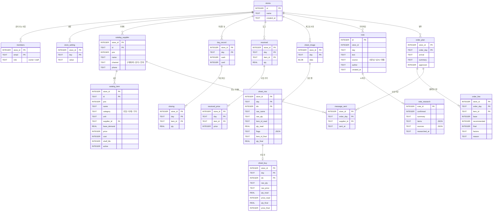

# fresh-stock 데이터 설계 (ERD)

| 항목 | 내용 |
|---|---|
| 문서 | 데이터 설계 v1.0 (스키마 버전 2) |
| 근거 | [PRD.md](PRD.md), [SDD.md](SDD.md) |
| DB | SQLite (기본), PostgreSQL 16 / Supabase |
| 최종 수정 | 2026-10-15 |

## 1. 설계 원칙

- 가게가 실제로 남기는 기록만 저장한다: 입고, 마감 재고, 돈통 현금과 카드 합계. 판매량, 떨이 양, 추정 매출은 저장하지 않고 이 기록으로 계산한다.
- 가게별로 나눈다. `stores`, `meta`, `note_research`를 뺀 모든 테이블은 `store_id`를 키의 첫 열로 가진다. `note_research`는 `note`를 거쳐서만 읽고 지운다.
- AI가 읽은 값과 사람이 확정한 값을 함께 남긴다 (`*_read`, `*_final`). 인식 정확도와 가게 줄임말 사전이 이 차이에서 나온다.
- 날짜는 한국 시간 기준 `YYYY-MM-DD` 문자열(TEXT), 시각은 `+09:00`이 붙은 ISO 문자열이다.
- 수량은 반 박스가 있어 실수(DOUBLE PRECISION), 발주 수량과 금액은 정수다.
- 외래 키 제약은 걸지 않는다. 품목 id는 가게가 목록을 고치기 전에는 기본 목록(파일)을 가리키고, 취급을 그만둔 품목도 지난 기록에 남아야 하기 때문이다. 관계는 코드가 지킨다.
- 하루치 묶음(마감 재고, 발주 줄, 재고표 줄, 품목 목록)은 고칠 때 지우고 다시 넣는다. 한 묶음은 100줄 안팎이다.

## 2. 관계도

`meta`는 다른 테이블과 관계가 없어 그림에서 뺐다. 품목을 가리키는 `item_id`(closing, received, received_price, sheet_row, order_line)는 6절에 따로 적는다.

## 3. 테이블

### 3.1 가게와 사람

#### meta

스키마 정보

| 열 | 타입 | 키 | 설명 |
|---|---|---|---|
| key | TEXT | PK | `schema_version` |
| value | TEXT | | `2` |

#### stores

가게

| 열 | 타입 | 키 | 설명 |
|---|---|---|---|
| id | INTEGER 자동 증가 | PK | 가게 번호 |
| name | TEXT | | 가게 이름 (바꿀 수 있다) |
| created_at | TEXT | | 만든 시각 |

#### members

가게를 같이 쓰는 사람

| 열 | 타입 | 키 | 설명 |
|---|---|---|---|
| store_id | INTEGER | PK | |
| email | TEXT | PK | 구글 계정 이메일 (소문자로 저장) |
| role | TEXT | | `owner` 사장님, `staff` 직원 |

- 가게를 만든 사람을 `owner`로 넣는다. 마지막 `owner`는 지울 수 없다.

### 3.2 가게 설정

#### store_setting

키-값 설정. 없는 키는 기본값을 쓴다.

| 열 | 타입 | 키 | 설명 |
|---|---|---|---|
| store_id | INTEGER | PK | |
| key | TEXT | PK | 아래 표 |
| value | TEXT | | |

| key | 값 | 기본 |
|---|---|---|
| `market_days` | 5일장 날짜 끝자리, 쉼표 구분 (`2,7`). 빈 문자열은 장 없음 | `2,7` |
| `closed_weekdays` | 입고 없는 요일 (월=0 … 일=6), 쉼표 구분 | `6` |
| `knowledge` | 사장님 경험 노트 (4,000자 이하). 빈 문자열이면 노트 없이 판단 | 기본 경험 노트 |
| `sheet_layout` | `simple` (품목·남은 수량), `store` (사입 칸 두 묶음) | `simple` |

#### catalog_supplier

거래처

| 열 | 타입 | 키 | 설명 |
|---|---|---|---|
| store_id | INTEGER | PK | |
| id | TEXT | PK | `garak`, `tofu`, 새로 만들면 `supplier1`, `supplier2` … |
| pos | INTEGER | | 보여 주는 순서 |
| name | TEXT | | 1~30자, 가게 안에서 중복 불가 |
| channel | TEXT | | `구매목록`, `문자`, `전화` |
| phone | TEXT | | 문자·전화 버튼 번호. 숫자, `-`, `+`, 공백. 빈 문자열이면 번호 없음 |

#### catalog_item

품목

| 열 | 타입 | 키 | 설명 |
|---|---|---|---|
| store_id | INTEGER | PK | |
| id | TEXT | PK | `apple`, `tomato`, 새로 만들면 `item1`, `item2` … 한 번 정하면 바꾸지 않는다 |
| pos | INTEGER | | 재고표·발주·문자에 나오는 순서 |
| name | TEXT | | 재고표에 적는 정식 이름, 1~20자, 가게 안에서 중복 불가 |
| category | TEXT | | `과일`, `야채`, `기타` |
| unit | TEXT | | `박스`, `봉`, `망`, `개`, `판`, `팩`, `단`, `모`, `kg`. 박스만 반 단위 |
| supplier_id | TEXT | | catalog_supplier.id |
| base_demand | DOUBLE PRECISION | | 평일 하루 판매량. 기록이 생기기 전 첫 추천에만 쓴다 |
| price | INTEGER | | 단위당 판매가 (원) |
| cost | INTEGER | | 단위당 매입가 (원). 사입 가격 검사 기준 |
| shelf_life | INTEGER | | 정가로 파는 일수 (1~30). 지나면 떨이 |
| active | INTEGER | | 1 취급 중, 0 취급을 그만둠 (지난 기록용으로 남긴다) |

- 가게가 품목이나 거래처를 처음 고칠 때 기본 목록 전체를 이 두 테이블로 옮기고, 그 뒤로는 가게 목록만 쓴다. 행이 하나도 없으면 기본 목록을 쓴다.
- 고칠 때마다 가게의 두 테이블을 통째로 지우고 다시 넣는다.
- 품목이 남아 있는 거래처(취급을 그만둔 품목 포함)는 지우지 않는다.

### 3.3 하루 기록

#### day_record

마감한 날. 이 행이 있으면 그날은 마감됐다.

| 열 | 타입 | 키 | 설명 |
|---|---|---|---|
| store_id | INTEGER | PK | |
| day | TEXT | PK | 마감한 날 |
| cash | INTEGER | | 돈통 현금 합계 (원) |
| card | INTEGER | | 카드 합계 (원) |

#### closing

마감 재고

| 열 | 타입 | 키 | 설명 |
|---|---|---|---|
| store_id | INTEGER | PK | |
| day | TEXT | PK | 마감한 날 (day_record.day) |
| item_id | TEXT | PK | 품목 |
| qty | DOUBLE PRECISION | | 남은 수량. 취급 중인 모든 품목을 0까지 넣는다 |

#### received

입고

| 열 | 타입 | 키 | 설명 |
|---|---|---|---|
| store_id | INTEGER | PK | |
| day | TEXT | PK | 들어온 날 |
| item_id | TEXT | PK | |
| qty | DOUBLE PRECISION | | 들어온 양 |

- 발주를 승인하면 입고일 행을 승인 수량으로 채운다. 그날 마감 전까지 실제 양으로 고친다.
- 사입 칸 형식이면 마감 확정 때 종이의 사입 수량으로 바꾼다.
- 아직 마감하지 않은 날의 행이 있을 수 있다 (내일 입고분).

#### received_price

사입 가격 (사입 칸 형식만)

| 열 | 타입 | 키 | 설명 |
|---|---|---|---|
| store_id | INTEGER | PK | |
| day | TEXT | PK | |
| item_id | TEXT | PK | |
| price | INTEGER | | 단위당 산 가격 (원) |

- 사입 금액(홈 매출 표) = Σ received.qty × received_price.price, 같은 (가게, 날, 품목)끼리.
- 품목별 가장 최근 사입 가격이 다음 재고표 사입 가격 검사의 기준이다.

### 3.4 재고표

#### sheet_image

재고표 원본 사진

| 열 | 타입 | 키 | 설명 |
|---|---|---|---|
| store_id | INTEGER | PK | |
| day | TEXT | PK | 재고표 날짜 |
| data | BLOB / BYTEA | | JPEG·PNG 원본 |

- 같은 날 다시 찍으면 덮어쓰고, 그날의 sheet_row·sheet_buy도 지우고 다시 넣는다.

#### sheet_row

AI가 읽은 줄과 사람이 확정한 값

| 열 | 타입 | 키 | 설명 |
|---|---|---|---|
| store_id | INTEGER | PK | |
| day | TEXT | PK | |
| idx | INTEGER | PK | 줄 번호 (0부터, 읽은 순서) |
| raw_name | TEXT | | 적힌 이름 그대로 |
| raw_qty | TEXT | | 적힌 수량 그대로 (`4반`, `x`) |
| item_id_read | TEXT | NULL 가능 | AI가 맞춘 품목. 못 찾으면 NULL |
| qty_read | DOUBLE PRECISION | NULL 가능 | 코드가 해석한 수량. 못 하면 NULL |
| flags | TEXT | | 확인 표시 이유 목록 (JSON 배열). 빈 배열이면 확인 필요 없음 |
| item_id_final | TEXT | NULL 가능 | 사람이 확정한 품목. 확정 전 NULL |
| qty_final | DOUBLE PRECISION | NULL 가능 | 사람이 확정한 수량 |

- 확정하면 읽은 줄의 item_id_final, qty_final을 채운다. 확인 화면에서 사람이 더한 줄(빠진 품목, 재고표에 없던 품목)은 sheet_row에 넣지 않고 closing에만 반영한다.
- 인식 정확도: item_id_final이 있는 줄 수, 그중 (item_id_read, qty_read) ≠ (item_id_final, qty_final)인 줄 수, 그중 flags가 비어 있지 않은 줄 수.
- 줄임말 사전: item_id_final이 있는 줄을 (raw_name, item_id_final)로 세어 이름마다 가장 많은 품목.

#### sheet_buy

사입 칸 (사입 칸 형식만, sheet_row와 같은 줄 번호)

| 열 | 타입 | 키 | 설명 |
|---|---|---|---|
| store_id | INTEGER | PK | |
| day | TEXT | PK | |
| idx | INTEGER | PK | sheet_row.idx |
| raw_qty | TEXT | | 적힌 사입 수량 |
| raw_price | TEXT | | 적힌 사입 가격 (쉼표 그대로) |
| qty_read | DOUBLE PRECISION | NULL 가능 | 해석한 사입 수량 |
| price_read | INTEGER | NULL 가능 | 해석한 사입 가격 |
| qty_final | DOUBLE PRECISION | NULL 가능 | 확정한 사입 수량 (빈 칸 = 안 들어옴) |
| price_final | INTEGER | NULL 가능 | 확정한 사입 가격 |

- 읽을 때는 사입 칸이 하나라도 적힌 줄만 행을 만든다. 확정할 때 모든 줄(사람이 더한 줄 포함)의 qty_final, price_final을 넣거나 고친다.

### 3.5 가게 메모

#### note

가게 메모

| 열 | 타입 | 키 | 설명 |
|---|---|---|---|
| id | INTEGER 자동 증가 | PK | |
| store_id | INTEGER | | |
| day | TEXT | | 메모가 영향을 주는 날 |
| text | TEXT | | 메모 글 (`비 예보 (강수확률 80%)`, `추석 2일 전 (명절 대목)`, 사장님이 쓴 글) |
| source | TEXT | | `사장님`, `날씨`, `명절` |
| author | TEXT | | 쓴 사람 이메일. 자동 메모는 빈 문자열 |
| created_at | TEXT | | 쓴 시각 |

- 자동 메모는 같은 (가게, 날, 글)이 있으면 다시 넣지 않는다. 새 예보를 받으면 그 기간의 이전 날씨 메모를 지운다.
- 과거 비슷한 날 검색은 메모가 있던 날을 문서 단위로 쓴다.

#### note_research

사장님 메모를 AI가 웹 검색으로 확인한 결과 (메모당 하나)

| 열 | 타입 | 키 | 설명 |
|---|---|---|---|
| note_id | INTEGER | PK | note.id |
| confirmed | INTEGER | | 1 출처로 확인함, 0 확인 못 함 (검색하지 않았거나 실패 포함) |
| summary | TEXT | | 사장님이 읽을 한두 문장. 실패하면 `AI가 조사하지 못했습니다: 이유` |
| items | TEXT | | 영향받을 품목 id 목록 (JSON 배열) |
| sources | TEXT | | `[{"title", "url"}]` (JSON). http·https 주소만 |
| researched_at | TEXT | | 확인한 시각 |

- 행이 없으면 아직 확인하지 않은 메모다. 발주 추천을 만들 때 이런 메모만 조사한다.
- 메모를 지우면 이 행도 지운다. 가게 구분 열이 없으므로 반드시 note의 store_id로 거른 뒤 지운다.

### 3.6 발주와 주문

#### order_plan

발주 (발주일당 하나)

| 열 | 타입 | 키 | 설명 |
|---|---|---|---|
| store_id | INTEGER | PK | |
| order_day | TEXT | PK | 발주일 = 마감한 날 |
| arrival | TEXT | | 입고일 (order_day 다음 날) |
| summary | TEXT | | 사장님께 보여 줄 요약 (AI 요약, 또는 "가게 메모가 없어 평소 패턴 기준으로 추천", "발주 안 함 (건너뜀)") |
| approved | INTEGER | | 0 추천만 있음, 1 승인함 |

- 승인 전 추천은 품목 구성이나 입고 요일이 바뀌면 지우고 다시 만든다. 승인한 발주는 지우지 않는다.

#### order_line

품목별 발주 수량

| 열 | 타입 | 키 | 설명 |
|---|---|---|---|
| store_id | INTEGER | PK | |
| order_day | TEXT | PK | order_plan.order_day |
| item_id | TEXT | PK | 추천을 만들 때 취급하던 품목 전부 |
| base | INTEGER | | 기본 추천 (요일·장날) |
| recommended | INTEGER | | 메모를 반영한 추천. 메모가 없거나 AI가 실패하면 base와 같다 |
| final | INTEGER | | 승인한 수량. 승인 전에는 recommended |
| factors | TEXT | | 날짜별 수요 배율 (`10-16 ×1.8, 10-17 ×1`). AI가 바꾼 품목만 |
| reason | TEXT | | 바꾼 이유. 여러 개면 ` / `로 잇는다 |

- 평소와 바뀐 품목 = recommended ≠ base인 줄.
- 입력 실수 검사(추천이 없는 품목)의 기준인 지난 발주는 approved = 1인 order_plan의 final을 최근 10건까지 쓴다.

#### message_sent

주문을 보낸 표시

| 열 | 타입 | 키 | 설명 |
|---|---|---|---|
| store_id | INTEGER | PK | |
| order_day | TEXT | PK | order_plan.order_day |
| supplier_id | TEXT | PK | 거래처 |
| sent_at | TEXT | | 문자·전화·복사 버튼을 마지막으로 누른 시각 |

## 4. 코드 값

| 열 | 값 |
|---|---|
| members.role | `owner`, `staff` |
| catalog_supplier.channel | `구매목록`, `문자`, `전화` |
| catalog_item.category | `과일`, `야채`, `기타` |
| catalog_item.unit | `박스`, `봉`, `망`, `개`, `판`, `팩`, `단`, `모`, `kg` |
| catalog_item.active | 1, 0 |
| note.source | `사장님`, `날씨`, `명절` |
| order_plan.approved, note_research.confirmed | 1, 0 |
| sheet_row.flags 항목 | `품목을 찾지 못함`, `수량을 해석하지 못함`, `글씨가 애매함`, `고쳐 쓴 칸`, `<단위> 단위로 맞지 않는 수량`, `어제 재고와 오늘 입고를 합친 N보다 많음`, `예상 재고 N보다 크게 적음`, `같은 품목이 두 번 나옴`, `확인된 줄임말(이름)과 다름`, `사입 수량을 해석하지 못함`, `사입 가격을 해석하지 못함`, `사입 수량·가격 중 하나만 있음`, `최근 사입가 N원과 크게 다름`, `평소 매입가 N원과 크게 다름`, `주문 N단위인데 사입 칸이 비어 있음` |

## 5. 날짜의 뜻

| 열 | 뜻 |
|---|---|
| day_record.day, closing.day | 마감한 날 |
| sheet_image.day, sheet_row.day, sheet_buy.day | 그 재고표의 마감일 (확정 전에도 같은 날짜) |
| received.day, received_price.day | 물건이 들어온 날 |
| order_plan.order_day | 발주를 넣은 날 = 마감한 날 |
| order_plan.arrival | 그 발주가 들어오는 날. 이 발주로 arrival부터 다음 입고일 전날까지 버틴다 |
| note.day | 메모가 영향을 주는 날 (쓴 날이 아니다) |

## 6. 품목 참조

closing, received, received_price, sheet_row(item_id_read, item_id_final), order_line, note_research.items의 품목 id는 그 가게의 catalog_item.id를 가리킨다. 가게가 목록을 고치기 전에는 기본 목록 파일(`data/catalog.csv`)의 id다. 기본 목록을 가게 목록으로 옮길 때 id를 그대로 쓰므로 지난 기록이 끊기지 않는다. 취급을 그만둔 품목은 active = 0으로 남아 지난 기록의 이름·단위·가격을 계속 알려 준다.

## 7. 하루 흐름과 쓰는 테이블

| 단계 | 쓰기 |
|---|---|
| 가게 만들기 | stores, members (owner) |
| 사람 넣기·빼기 | members |
| 설정 저장 | store_setting, catalog_supplier, catalog_item (승인 전 order_plan·order_line 삭제) |
| 메모 적기, 자동 메모 | note |
| 메모 AI 확인 | note_research |
| 입고 고치기 | received |
| 재고표 읽기 | sheet_image, sheet_row, sheet_buy |
| 마감 확정 | sheet_row·sheet_buy의 *_final, closing, day_record (사입 형식이면 received, received_price) |
| 발주 추천 | order_plan (approved 0), order_line |
| 발주 승인 | order_plan (approved 1), order_line.final, 입고일의 received |
| 주문 보내기 | message_sent |
| 쉬는 날 건너뛰기 | 재고표 차례: closing (전날 재고 + 입고), day_record (0, 0). 발주 차례: order_plan (approved 1, 전 품목 final 0), 입고일 received 비움 |

## 8. 저장하지 않고 계산하는 값

| 값 | 계산 |
|---|---|
| 지금 할 일과 날짜 | 마지막 day_record.day, 그 다음 날의 입고 여부, 그날 order_plan.approved |
| 품목별 소진량 | 어제 closing + 오늘 received − 오늘 closing |
| 떨이 양 | 어제 closing 중 최근 (shelf_life − 1)일 입고를 넘는 양 |
| 정가 판매, 수요 기록 | 소진량 − 떨이 양 (다 팔린 날 ×1.3) |
| 추정 매출 | 정가 판매 × price + 떨이 양 × price × 0.5 |
| 실제 매출 | day_record.cash + card |
| 예상 재고 | 어제 closing + 오늘 received − 최근 7일 평균 정가 판매 |
| 과거 비슷한 날 문서 | note와 위 값으로 서버 메모리에서 만든다 (캐시) |
| 줄임말 사전, 인식 정확도 | sheet_row |

## 9. DB별 차이와 변경 관리

| 항목 | SQLite | PostgreSQL |
|---|---|---|
| 자동 증가 키 (stores.id, note.id) | `INTEGER PRIMARY KEY AUTOINCREMENT` | `BIGSERIAL PRIMARY KEY` |
| 사진 | BLOB | BYTEA |
| 자리표시자 | `?` | `%s` (코드가 바꾼다) |

- 시작할 때 모든 테이블을 `CREATE TABLE IF NOT EXISTS`로 만들고 `meta.schema_version`을 넣는다.
- 나중에 더한 열은 시작할 때 있는지 확인하고 `ALTER TABLE … ADD COLUMN`으로 더한다. 지금까지 더한 열: `catalog_supplier.phone TEXT NOT NULL DEFAULT ''`.
- 가게 구분(store_id)이 없던 예전 형식은 이어 쓰지 않는다. 시작할 때 새 DB로 시작하라는 오류를 낸다.
- DB를 옮길 때(`copy-db`)는 위 테이블 순서대로 모든 행을 옮기고, stores·note의 자동 증가 값을 옮긴 최댓값 다음으로 맞춘다.
- 인덱스는 기본 키만 둔다. 조회는 모두 가게(+날짜) 앞부분 키로 한다.
