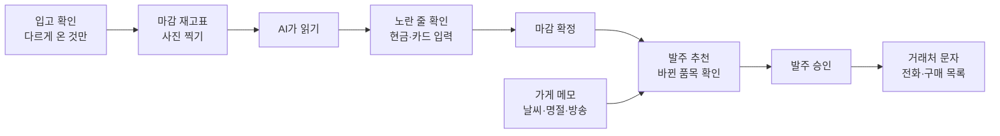

# fresh-stock 제품 요구사항 (PRD)

| 항목 | 내용 |
|---|---|
| 제품 | fresh-stock, 청과 가게 마감·발주 도우미 |
| 문서 | 제품 요구사항 v1.0 |
| 관련 문서 | [SDD.md](SDD.md) (설계), [ERD.md](ERD.md) (데이터) |
| 최종 수정 | 2026-10-15 |

## 1. 개요

손으로 적은 마감 재고표를 사진 한 장으로 기록하고, 다음 날 발주 수량을 추천받아 승인하면 거래처별 주문 문자까지 만들어 주는 모바일 웹이다. 포스기 없이 운영하는 과일·야채 가게를 대상으로 한다.

## 2. 배경

대상 가게는 과일·야채 60~90종을 팔고 직원이 5~7명이다. 지금 하루 마감은 이렇게 돌아간다.

- 마감 1시간 전부터 품목별 남은 수량을 종이 재고표에 적는다. 재고 정리, 발주, 매출 계산까지 2~3시간이 걸린다.
- 포스기가 없어 품목별 판매량이 남지 않는다. 남는 기록은 돈통 현금과 카드 단말기 합계뿐이다.
- 발주량은 어제 판매량을 보고 감으로 정한다. 가락시장이 일요일에 쉬어 토요일에는 이틀 치를 들이고, 5일장 날은 더 팔린다는 것도 머릿속으로 계산한다.
- 물건은 버리지 않는다. 상태가 나빠지면 떨이로 싸게 판다. 그래서 많이 들인 만큼 손해가 떨이 할인으로 나타난다.
- 입력 실수 한 번(토마토 8박스를 88박스로)이 그대로 주문돼 며칠 동안 헐값 떨이로 이어진 적이 있다.

## 3. 목표와 범위

### 3.1 목표

| 번호 | 목표 |
|---|---|
| G1 | 마감 입력을 줄인다. 재고표는 지금처럼 종이에 적고, 사람은 확인이 필요한 줄만 본다 |
| G2 | 근거 있는 발주를 추천한다. 요일·장날·입고 요일을 반영한 기본 추천에 날씨·명절·방송 같은 가게 메모와 과거 비슷한 날의 실제 기록을 더한다 |
| G3 | 읽기 오류와 입력 실수가 확인 없이 저장되거나 주문되지 않게 한다 |
| G4 | 승인한 수량 그대로 거래처별 주문 문자·통화 메모·구매 목록을 만든다 |

### 3.2 범위 밖

- 포스기·카드 단말기 연동, 품목별 실제 판매 기록
- 거래처에 자동 전송 (휴대폰의 문자·전화 앱을 여는 데까지만 한다)
- 시세 연동, 가격 자동 변경, 계절별 수요 변화
- 종이 재고표를 대신하는 앱 입력
- 회계, 세금 신고

## 4. 사용자

| 사용자 | 하는 일 | 권한 |
|---|---|---|
| 사장님 (owner) | 매일 업무 전부, 가게 설정, 같이 쓰는 사람 관리 | 전부 |
| 직원 (staff) | 재고표 올리기·확인, 입고 확인, 발주 확인·승인, 주문 보내기, 가게 메모 | 가게 설정은 보기만 |
| 거래처 | 주문 문자·전화를 받는다. 앱을 쓰지 않는다 | 없음 |

쓰는 상황은 마감 직후(보통 밤 9~12시)다. 하루 일을 마치고 지친 상태로, 가게 조명 아래에서 휴대폰을 한 손에 들고 쓴다. 한 사람이 가게 여러 곳(본점, 장터점)에 속할 수 있다.

## 5. 제품 원칙

1. 현장 습관을 바꾸지 않는다. 종이 재고표를 그대로 쓰고 사진으로 입력한다. 떨이로 나간 양을 따로 적게 하지 않는다 (입고일과 품목별 정가 판매 기간으로 추정한다).
2. 숫자는 코드가, 판단과 글은 AI가 맡는다. AI는 손글씨 옮기기, 품목 맞추기, 메모를 읽고 "평소의 몇 배"를 판단하기, 인사말 쓰기만 한다. 수량 해석, 판매량 계산, 발주 수량, 이상한 값 검사, 문자 속 수량은 모두 코드가 정한다.
3. 사람이 확인하고 승인한다. 확인할 칸만 보여 주고, 발주는 사람이 승인해야 나간다.
4. AI가 실패해도 하루 업무는 끝난다. 재고표를 못 읽으면 다시 찍게 하고, 발주 AI가 실패하면 기본 추천을 쓰고, 메모 확인이 실패하면 "확인 못 함"으로 남기고 넘어간다.

## 6. 하루 흐름

1. (선택) 오늘 들어온 물건이 주문과 다르면 다르게 온 품목만 고친다.
2. 마감 후 재고표 사진을 찍는다. AI가 1분 안에 읽는다.
3. 노란 줄만 확인하고 돈통 현금·카드 합계를 넣어 마감을 확정한다.
4. 발주 추천에서 평소와 바뀐 품목을 보고, 필요하면 수량을 고쳐 승인한다.
5. 거래처별로 문자를 보내거나 전화를 건다.

가게 메모는 언제든 적는다. 가게를 쉰 날은 건너뛴다.

## 7. 기능 요구사항

### 7.1 계정과 가게

| ID | 요구사항 |
|---|---|
| ACC-01 | 구글 계정으로 로그인한다. 이메일이 확인된 계정만 받고, 로그인은 30일 동안 유지한다 |
| ACC-02 | 가게를 처음 만든 사람이 사장님이 된다 |
| ACC-03 | 사장님은 구글 이메일로 같이 쓰는 사람을 넣고 뺀다 (사장 또는 직원). 마지막 사장님은 뺄 수 없다 |
| ACC-04 | 가게가 하나면 로그인하자마자 그 가게를 연다. 여럿이면 고르고, 쓰는 중에 바꿀 수 있다 |
| ACC-05 | 재고, 발주, 메모, 재고표, 설정, AI 기록은 모두 가게별로 나뉜다. 그 가게 멤버가 아니면 어떤 화면도 볼 수 없다 |
| ACC-06 | 사장님은 가게 이름을 바꿀 수 있다 |
| ACC-07 | PC에서 확인할 때를 위해 이메일만 넣는 개발용 로그인을 둔다. 운영에서는 끈다 |

### 7.2 오늘 할 일

| ID | 요구사항 |
|---|---|
| HOME-01 | 홈 맨 위에 지금 할 일 하나와 버튼 하나를 보여 준다: 재고표 찍기, 노란 줄 고치기, 발주 확인, 문자 보내기 |
| HOME-02 | 오늘 순서 4단계(찍기 → 확인 → 승인 → 문자)와 어디까지 했는지 보여 준다 |
| HOME-03 | 할 일 날짜가 오늘보다 밀렸으면 알린다. 그날 가게를 쉬었다면 건너뛸 수 있다. 재고표 차례면 그날은 아무것도 안 팔린 날로(재고 = 전날 재고 + 입고, 매출 0), 발주 차례면 발주 없이 넘어간다. 오늘 이후의 날은 건너뛸 수 없다 |
| HOME-04 | 최근 7일 매출을 보여 준다: 실제 매출(현금 + 카드), 재고로 추정한 매출과 차이, 사입 금액, 장날 표시 |

### 7.3 재고표 사진 인식

| ID | 요구사항 |
|---|---|
| SHEET-01 | 카메라로 찍거나 사진첩에서 고르면 바로 올라가 읽기 시작한다 |
| SHEET-02 | 줄마다 적힌 이름과 수량을 적힌 그대로 옮기고 가게 품목 중 맞는 것을 고른다. 줄임말(방토 = 방울토마토), 반 박스(`반`, `4반`, `4.5`), 단위가 붙은 수량(`3박스`), 0 표기(`x`, `-`, `0`, `ㅇ`, `○`, `없음`, `품절`)를 읽는다 |
| SHEET-03 | 재고표 형식은 두 가지다. `품목 · 남은 수량`, 그리고 실제 가게 종이처럼 `품목 · 남은 수량 · 사입 수량 · 사입 가격` 네 칸이 왼쪽·오른쪽 두 묶음인 형식. 사입 가격은 `42000`, `42,000`, `4.2만`, `4만2천`, `3만8`처럼 적어도 읽는다 |
| SHEET-04 | 아래 경우에 확인 표시를 붙인다 (7.3.1) |
| SHEET-05 | 사람이 확정한 "적힌 이름 → 품목" 기록으로 그 가게의 줄임말을 익혀 다음 재고표부터 쓴다. 익힌 줄임말과 다른 품목으로 맞추면 확인 표시를 붙인다 |
| SHEET-06 | 읽기에 실패하면 이유와 다시 찍는 요령을 보여 준다 |
| SHEET-07 | 원본 사진은 그날 기록과 함께 보관하고, 확인 화면에서 크게 볼 수 있다 |
| SHEET-08 | 품목 이름이 찍힌 인쇄용 빈 재고표(두 묶음)를 내려받을 수 있다 |

#### 7.3.1 확인 표시 조건

| 조건 | 왜 |
|---|---|
| 품목을 찾지 못함 | 저장할 수 없다 (빨간 줄) |
| 수량을 해석하지 못함 | 숫자가 없다 |
| AI가 글씨가 애매하다고 함 | 모델 스스로 자신 없음 |
| 줄 긋고 고쳐 쓴 칸 | 지운 숫자까지 읽기 쉽다 |
| 단위에 안 맞는 수량 | 박스는 반 단위, 나머지는 정수 |
| 어제 재고 + 오늘 입고보다 많음 | 불가능한 값 (8을 88로) |
| 예상 재고보다 크게 적음 (4 이상 적고 예상의 25% 이하) | 11을 1로 읽은 경우 |
| 같은 품목이 두 번 | 창고·진열대를 나눠 적었거나 잘못 맞춤 |
| 익힌 줄임말과 다름 | 가게 고유 약어 혼동 |
| 사입 수량·가격 중 하나만 있음, 해석 못 함 | 사입 형식 |
| 사입 가격이 최근 사입가(없으면 매입가)와 2.5배 넘게 다름 | 자릿수 오독 |
| 주문했는데 사입 칸이 비어 있음 | 못 읽었거나 안 들어옴 |

### 7.4 재고 확인과 마감 확정

| ID | 요구사항 |
|---|---|
| CONF-01 | 확인할 줄을 화면 맨 위 카드로 모은다. 노란 줄은 확인 필요, 빨간 줄은 품목을 몰라 이대로는 저장할 수 없는 줄이다 |
| CONF-02 | 노란 줄은 [맞아요]를 누르거나 값을 고치면 확인된다. 못 읽은 칸은 숫자를 넣어야 확인된다 |
| CONF-03 | 끝자리를 두 번 읽은 것 같은 값(88)은 고칠 값(8)을 [8로 고치기]로 제안한다. 고친 값도 가능한 양을 넘으면 제안하지 않는다 |
| CONF-04 | 재고표에 없는데 남아 있어야 할 품목(예상 재고 1 이상)도 노란 카드로 보여 준다. [0 맞아요] 또는 수량을 넣는다 |
| CONF-05 | 나머지 줄은 종이 순서대로 보여 주고, 누르면 그 줄을 고친다. 빠진 품목을 더할 수 있다 |
| CONF-06 | 빨간 줄의 품목 고르기 맨 위에 적힌 이름과 비슷한 품목 2~3개를 보여 준다 (토마 → 토마토, 굴 → 귤) |
| CONF-07 | 돈통 현금과 카드 합계를 넣어야 한다. 없는 날은 0을 넣는다 |
| CONF-08 | 확인하지 않은 노란 줄, 빨간 줄, 빈 현금·카드가 있으면 확정하지 않는다. 화면에서 막고, 서버도 같은 규칙으로 거부한다 |
| CONF-09 | 확정하면 재고표에 없는 품목은 0, 같은 품목 두 줄은 더해 저장한다 (창고 + 진열대). 사입 형식이면 사입 칸을 그날 입고와 사입 가격으로 기록한다 |
| CONF-10 | 확정에 실패하면 사람이 넣은 값을 그대로 둔 채 이유를 보여 준다 |

### 7.5 입고

| ID | 요구사항 |
|---|---|
| RECV-01 | 발주를 승인하면 그 수량을 입고일의 입고로 기록한다 |
| RECV-02 | 그날 재고표를 확정하기 전까지 다르게 들어온 품목만 실제 양으로 고친다. 주문에 없던 품목도 더한다 |
| RECV-03 | 사입 칸이 있는 형식을 쓰는 가게는 재고표가 입고 기록을 대신하므로 입고 고치기를 쓰지 않는다 |

판매량을 "어제 재고 + 오늘 입고 − 오늘 재고"로 계산하므로, 입고가 틀리면 판매량과 다음 발주가 같이 틀린다.

### 7.6 가게 메모

| ID | 요구사항 |
|---|---|
| NOTE-01 | 영향을 줄 날짜(기본 내일, 일주일 안)를 골라 메모를 적고 지운다 |
| NOTE-02 | 날씨 메모를 자동으로 넣는다: 강수확률 60% 이상이면 비 예보, 낮 최고 33도 이상이면 폭염. 새 예보가 오면 바꾼다 |
| NOTE-03 | 설·추석은 3일 전부터 당일까지 "명절 대목", 다음 날은 "연휴, 손님 적음"을 자동으로 넣는다 |
| NOTE-04 | 사장님이 적은 메모는 발주 추천을 만들 때 AI가 웹 검색으로 확인한다. 확인 여부, 한두 문장 요약, 영향받을 품목, 출처를 남긴다. 단골 주문처럼 가게 안의 일은 검색하지 않는다. 확인하지 못한 내용은 짐작해서 쓰지 않는다. 화면에서 지금 바로 확인할 수도 있다 |
| NOTE-05 | 메모 확인이 실패해도 발주 추천은 나간다 |

### 7.7 발주 추천

| ID | 요구사항 |
|---|---|
| ORD-01 | 마감한 날이 발주일, 다음 날이 입고일이다. 입고가 없는 요일이 뒤따르면 그날 치까지 함께 들인다 (일요일 휴장이면 토요일 입고분이 토·일 이틀 치) |
| ORD-02 | 기본 추천은 품목별로 최근 같은 요일의 정가 판매(떨이 제외, 다 팔린 날은 1.3배로 보정)와 장날 배율로 버틸 날의 수요를 예측하고, 여유분 20%를 더하고, 남은 재고를 빼서 정수로 올린다 |
| ORD-03 | 버틸 날에 가게 메모가 있으면 AI가 메모, 사장님 경험 노트, 과거 비슷한 날 기록을 보고 품목·분류·전체 단위로 날짜별 수요 배율과 이유를 낸다. 배율은 0.2~4.0으로 자르고, 수량은 코드가 계산한다 |
| ORD-04 | 과거 비슷한 날은 메모가 있던 날의 "실제 정가 판매 ÷ 평소 예측" 배율과 품절 품목 수를 기록에서 찾는다. 발주일 이전 기록만 쓴다 |
| ORD-05 | 메모가 없는 날은 AI를 부르지 않고 기본 추천을 쓴다 |
| ORD-06 | AI 요약과 함께, 코드가 계산한 "실제로 수량이 바뀐 품목"(기본 → 추천, 이유)을 따로 보여 준다. AI 문장만 믿지 않게 한다 |
| ORD-07 | 거래처별로 품목·남은 수량·추천·발주 칸을 보여 준다. 추천도 재고도 없는 품목은 접어 둔다 |
| ORD-08 | 참고한 메모, AI 확인 결과와 출처, 참고한 과거 기록을 볼 수 있고, 메모를 고친 뒤 추천을 다시 만들 수 있다 |
| ORD-09 | 추천은 3분 안에 나온다. 두 사람이 동시에 열어도 한 번만 만든다 |
| ORD-10 | 품목 구성이나 입고 요일이 바뀌면 승인 전 추천을 지우고 다시 만든다 |

### 7.8 승인과 입력 실수 막기

| ID | 요구사항 |
|---|---|
| APV-01 | 입력한 수량이 추천의 3배 이상이고 3 이상 많으면 확인을 요구한다. 추천이 없으면 지난 승인 발주(3건 이상)의 하루 평균과 같은 기준으로 비교한다 |
| APV-02 | 확인이 필요한 줄에서 [추천값으로 고치기] 또는 [이 값 맞아요]를 고른다. "맞아요"는 그때 그 값에만 유효하고, 숫자를 바꾸면 다시 묻는다 |
| APV-03 | 발주 수량은 0 이상의 정수다 |
| APV-04 | 승인하면 입고를 기록하고 주문 보내기로 넘어간다 |

### 7.9 거래처 주문

| ID | 요구사항 |
|---|---|
| MSG-01 | 거래처마다 주문 방식이 있다. 구매목록은 분류별 목록(시장에 들고 가는 종이), 문자는 한 줄 주문, 전화는 통화하며 읽을 메모다 |
| MSG-02 | 품목과 수량은 승인한 발주에서 그대로 찍는다 |
| MSG-03 | AI 인사말은 켤 때만 넣는다. 인사와 끝맺음 한 문장씩만 쓰게 하고, 숫자가 들어 있거나 80자를 넘으면 빼고 보낸다 |
| MSG-04 | 거래처 전화번호가 있으면 문자 앱(내용이 채워진 채로)이나 전화를 바로 연다. 복사도 된다 |
| MSG-05 | 보낸 거래처는 보낸 시각으로 표시해 두 번 보내지 않게 한다. 홈에 아직 안 보낸 거래처를 보여 준다 |

### 7.10 가게 설정 (사장님)

| ID | 요구사항 |
|---|---|
| SET-01 | 품목: 이름(1~20자, 중복 불가), 분류(과일·야채·기타), 단위(박스·봉·망·개·판·팩·단·모·kg), 거래처, 판매가, 매입가, 하루 판매량(기록이 생기기 전 첫 추천용), 정가로 파는 기간(1~30일) |
| SET-02 | 품목은 지우지 않고 취급을 그만두거나 다시 취급한다. 지난 기록으로 판매량을 계산할 때 필요하다. 취급하는 품목은 하나 이상 있어야 한다 |
| SET-03 | 거래처: 이름(1~30자), 주문 방식, 전화번호. 품목이 남아 있는 거래처는 지울 수 없다 |
| SET-04 | 5일장 날짜(1·6일 ~ 5·10일, 없음)와 입고가 있는 요일(하루 이상) |
| SET-05 | 재고표 형식 (7.3 SHEET-03) |
| SET-06 | 사장님 경험 노트 (4,000자 이하). 발주 AI가 배율을 정할 때 읽는다 |
| SET-07 | 품목·거래처를 CSV로 내보내고 한꺼번에 바꾼다. CSV에서 빠진 품목은 취급을 그만둔 것으로 남긴다 |
| SET-08 | 고치기 전에는 기본값을 쓴다: 품목 64종·거래처 6곳, 2·7일장, 일요일 입고 없음, 기본 경험 노트 |

직원은 설정을 볼 수만 있다.

### 7.11 AI 기록

| ID | 요구사항 |
|---|---|
| LOG-01 | AI를 부를 때마다 가게별로 용도, 시각, 걸린 시간, 토큰, 결과 또는 실패 이유를 남긴다. 상세에서 보낸 내용과 받은 결과를 본다. 사진 원본은 기록하지 않는다 |
| LOG-02 | 재고표 읽기 정확도를 보여 준다: 확정한 줄, 사람이 고친 줄, 그중 확인 표시가 없던 줄. 익힌 줄임말도 보여 준다 |

### 7.12 대화로 쓰기

| ID | 요구사항 |
|---|---|
| CHAT-01 | Claude Code나 Claude Desktop에서 말로 같은 업무를 한다: 오늘 할 일, 메모, 입고, 재고표 읽기·확정, 발주 추천·승인, 주문 문자, 매출, 품목, 건너뛰기 |
| CHAT-02 | 웹과 같은 권한 규칙을 따른다. 설정한 이메일이 멤버인 가게만 다룬다 |
| CHAT-03 | 발주 승인은 사용자가 승인했다는 표시 없이는 거절한다. 입력 실수 경고가 나오면 승인하지 않고 사용자에게 다시 묻게 한다. 확인 표시가 붙은 줄은 사용자에게 확인받아야 확정한다 |

## 8. 화면

### 8.1 화면 목록

아래 탭 4개(오늘, 재고표, 발주, 더보기)로 오간다.

| 화면 | 내용 |
|---|---|
| 로그인 | 구글로 들어가기 |
| 가게 고르기 | 가게 간판 목록과 각 가게의 지금 할 일, 새 가게 만들기 |
| 오늘 (홈) | 지금 할 일 봉투 카드, 오늘 순서, 가게 메모, 최근 매출 |
| 재고표 올리기 | 찍기, 사진첩, 오늘 재고표·오늘 입고 상태, 잘 찍는 요령 |
| 재고표 확인 | 노란·빨간 카드, 재고표에 없는 품목, 종이 순서 전체, 빠진 품목 넣기, 현금·카드, 확정 |
| 발주 | AI 요약, 바뀐 품목, 거래처별 발주 칸, 확인할 숫자, 참고한 메모·기록, 승인 |
| 주문 보내기 | 거래처별 주문 쪽지, 문자·전화·복사, 보낸 표시, AI 인사말 켜기 |
| 더보기 | 품목·설정, 입고 확인, 가게 관리, AI 기록, 가게 바꾸기, 로그아웃 |
| 품목·설정 | 거래처별 품목, 거래처, 장날·입고 요일, 재고표 형식, 인쇄용 재고표, 경험 노트 |
| 품목 편집 | 품목 정보, 취급 그만두기 |
| 입고 확인 | 거래처별 주문 수량과 받은 수량 |
| 가게 관리 | 같이 쓰는 사람, 사람 넣기, 가게 이름 |
| AI 기록 | 정확도, 익힌 줄임말, 날짜별 호출, 호출 상세 |

### 8.2 디자인 규칙

가게의 모습(초록 차양 간판, 크라프트 종이, 가격표, 주문 쪽지)을 화면 틀로 쓴다. 색은 뜻을 하나씩만 가진다.

| 색 | 뜻 | 쓰는 곳 |
|---|---|---|
| 노랑 (가격표) | 확인 필요 | 재고표 노란 줄, 확인할 발주 수량. 다른 곳에 쓰지 않는다 |
| 빨강 | 이대로는 저장 못 함 | 품목을 모르는 줄, 밀린 날짜 |
| 보라 | AI가 판단한 것 | "AI 추천", "AI 추정", "AI 검색" 글자와 함께만 쓴다 |
| 초록 (잎) | 간판, 누르는 버튼, 확인함 | |

- 색만으로 뜻을 전하지 않는다. 항상 글자(확인, 저장 못 함, AI 추천)를 함께 쓴다.
- 본문 17px, 숫자 22px 이상. 누르는 곳은 48px 이상, 아래 고정 버튼은 56px.
- 수량 칸은 정수 칸과 [반] 칩으로 나눈다 (4 + 반 = 4.5). 금액 칸은 쉼표를 저절로 붙인다.
- 아래 고정 막대에 남은 노란 줄 수를 보여 주고, 다 확인해야 확정 버튼이 나온다. 회색으로 죽은 버튼은 두지 않는다.
- AI를 기다리는 동안 단계와 함께 덮개를 띄우고, 화면을 닫아도 결과는 홈에 다음 할 일로 뜬다고 알려 준다.
- 휴대폰 폭 390px 기준. PC에서는 가운데 480px 폭으로 보여 준다.

## 9. 비기능 요구사항

| 구분 | 요구사항 |
|---|---|
| 응답 시간 | 재고표 한 장 읽기 1분 이내. 발주 추천은 메모 확인을 포함해 3분 이내, 메모가 없는 날은 바로 |
| 실패 대응 | 5장 원칙 4. AI 호출 실패가 저장된 데이터를 바꾸지 않는다 |
| 날짜 | 서버가 어디서 돌든 날짜는 한국 시간으로 센다 |
| 보안 | 구글 OAuth, 서명된 세션 쿠키(https로 배포하면 secure), 모든 요청에서 로그인과 가게 멤버 여부 확인. 비밀값은 `.env`에만 두고, 화면 출력에서 DB 비밀번호를 가린다 |
| 데이터 | 기본은 SQLite 파일. PostgreSQL(Supabase)도 같은 코드로 쓴다. SQLite에서 PostgreSQL로 옮기는 명령을 둔다 |
| 비용 | 메모 없는 날은 발주 AI를 부르지 않는다. 짧은 판단은 추론 강도 low, 호출당 입력은 수천 토큰 안쪽 |
| 개인정보 | 재고표 사진은 그 가게 DB에만 둔다. AI 기록에는 사진 장수만 남긴다 |
| 호환 | 휴대폰 크롬·사파리 최신판. 브라우저가 일부 CSS를 지원하지 않아도 서버 검증으로 잘못된 저장을 막는다 |

## 10. 성공 기준

| 지표 | 기준 | 확인 방법 |
|---|---|---|
| 확인 표시 없이 틀린 값이 저장된 줄 | 0 | 합성 재고표 평가. 실제 사용에서는 사람이 고친 줄 중 확인 표시가 없던 줄 |
| 재고표 줄 정확도 (품목·수량 모두) | 97% 이상 | 합성 재고표 평가 |
| 입력 실수 차단 | 전부 차단, 오경보 0 | 가상 매장 90일 |
| 품절로 놓친 매출 | 기본 추천보다 줄어듦 | 가상 매장, 명절이 든 40일 |
| 이익 | 기본 추천보다 늘어남 | 같은 조건 |
| 마감 후 입력·발주 시간 | 2~3시간 → 30분 이내 | 실제 가게 |

실제 재고표 사진이 없을 때는 손글씨 글꼴로 만든 합성 재고표로 평가하고, 가게 매출 효과는 가상 매장으로 비교한다. 합성 결과는 파이프라인 검증이지 실제 인식률이 아니다.

## 11. 가정과 제약

- 물건은 버리지 않는다. 정가로 파는 기간이 지나면 떨이(정가의 절반)로 다 판다.
- 박스 품목은 반 박스까지 적고, 나머지는 정수로 적는다.
- 기본 입고는 가락시장 기준으로 일요일이 없고, 5일장은 2·7일이다. 가게마다 바꾼다.
- 판매량은 재고 차이로 계산하므로 입고 기록이 맞아야 한다.
- 품목 가격은 지금 값 하나만 둔다. 가격을 바꾸면 지난 날의 추정 매출도 새 가격으로 계산된다.

## 12. 다음 단계

- 실제 재고표 사진으로 인식 평가
- 실제 가게 메모로 과거 기록 검색 평가 셋 확장
- 운영 배포 (Supabase 연결), AI 호출 추적 도구 연동
