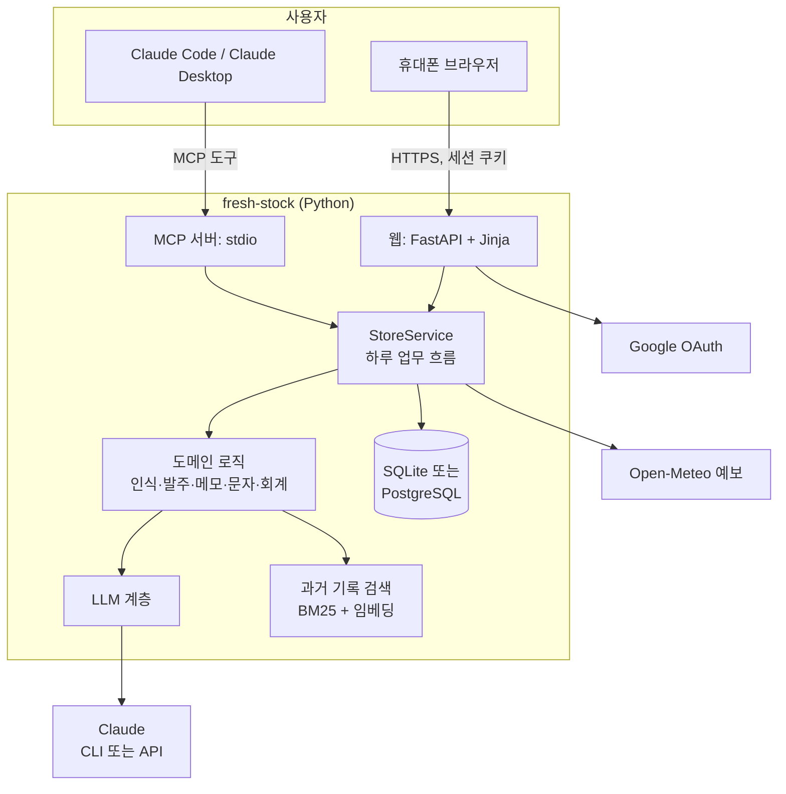
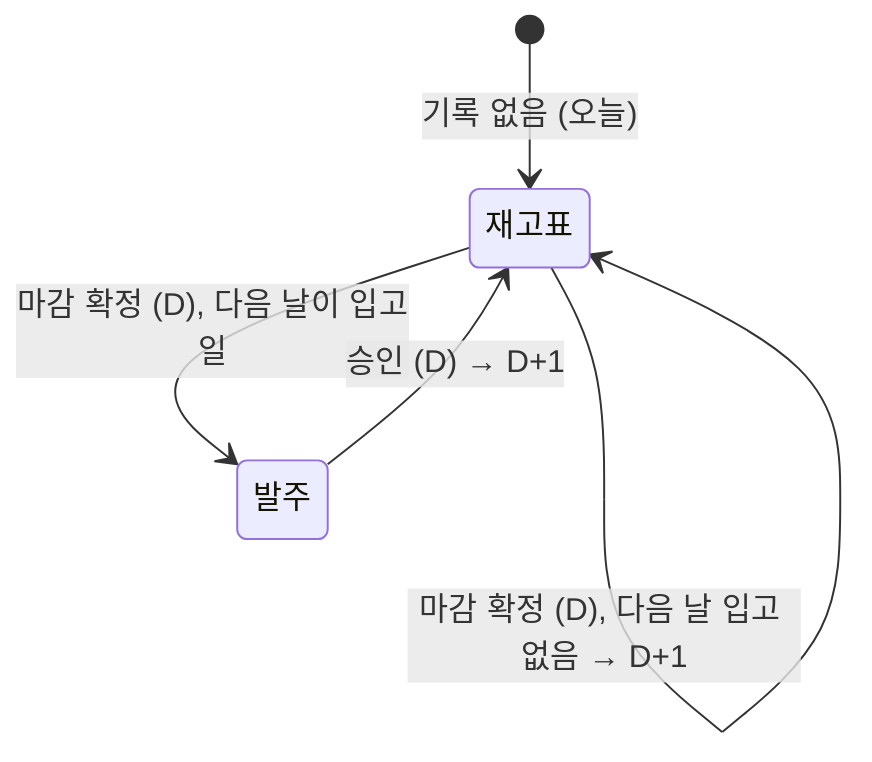
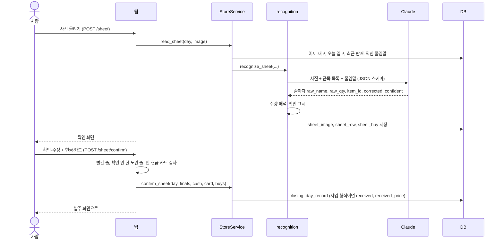
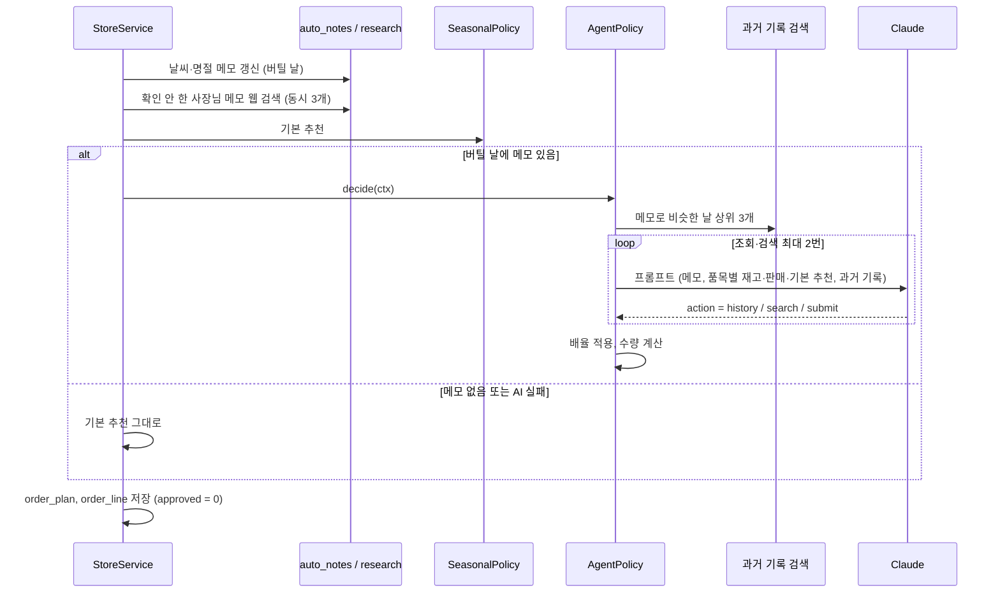

# fresh-stock 소프트웨어 설계 (SDD)

| 항목 | 내용 |
|---|---|
| 문서 | 소프트웨어 설계 v1.0 |
| 근거 | [PRD.md](PRD.md) |
| 데이터 | [ERD.md](ERD.md) |
| 최종 수정 | 2026-10-15 |

## 1. 범위

PRD의 기능을 어떤 구조와 규칙으로 만드는지 정한다. 테이블과 컬럼은 ERD에 둔다.

## 2. 시스템 구성



- 웹과 MCP 서버는 같은 `StoreService`를 쓴다. 업무 규칙은 서비스와 도메인 로직에만 있고, 웹·MCP는 입력을 받아 넘기고 결과를 보여 주기만 한다.
- 가게마다 `StoreService` 하나를 만든다. 서비스는 요청마다 가게 설정을 DB에서 다시 읽는다 (다른 화면이나 MCP에서 고쳤을 수 있다).
- AI가 하는 일은 LLM 계층을 거친다. 도메인 로직은 `generate_json`만 알고, 백엔드는 설정으로 고른다.

## 3. 기술 스택

| 영역 | 선택 |
|---|---|
| 언어·패키지 | Python 3.12, uv (빌드 백엔드 uv_build) |
| 웹 | FastAPI, Jinja2, Starlette SessionMiddleware, authlib (구글 OAuth) |
| 저장소 | SQLite (기본), PostgreSQL 16 / Supabase (psycopg 3, psycopg_pool) |
| AI | Claude Code CLI (`claude -p`, 기본) 또는 Anthropic Python SDK |
| 검색 | 글자 2-gram BM25 (직접 구현), fastembed + `minishlab/potion-multilingual-128M` (로컬), NumPy |
| 대화형 | MCP Python SDK (stdio 서버) |
| 외부 데이터 | Open-Meteo 예보·과거 예보 API (키 없음), `holidays` 패키지 (한국 공휴일) |
| 이미지 | Pillow (합성 재고표, 데모) |
| 화면 자산 | Pretendard (OFL), Fluent Emoji 품목·날씨 그림 (MIT), Lucide 아이콘 (ISC). 라이선스는 `static/LICENSES/` |
| 테스트 | pytest |

## 4. 모듈

`src/fresh_stock/`

| 모듈 | 책임 |
|---|---|
| `domain.py` | 품목(`Item`), 거래처(`Supplier`), 분류, 단위, 주문 방식 |
| `catalog.py` | 품목·거래처 목록. 기본 목록(`data/catalog.csv`, `suppliers.csv`), 취급을 그만둔 품목, CSV 내보내기·가져오기 |
| `market_calendar.py` | 5일장, 입고 요일, 버틸 날(`cover_days`), 한국 시간(`today_kst`) |
| `accounting.py` | 하루 기록(`DayRecord`), 소진량·떨이·정가 판매 계산 |
| `recognition.py` | 재고표 사진 인식: 프롬프트, 수량·가격 해석, 확인 표시 |
| `ordering.py` | 발주 문맥(`OrderContext`), 수요 기록, 기본 추천(`SeasonalPolicy`), 입력 실수 검사(`check_order`) |
| `agent.py` | 발주 에이전트: 조회·검색·제출 루프, 배율 적용 |
| `memory.py` | 과거 비슷한 날 검색 (RAG) |
| `auto_notes.py` | 날씨·명절 메모 수집 |
| `research.py` | 사장님 메모를 웹 검색으로 확인 |
| `messages.py` | 거래처별 주문 문자·통화 메모·구매 목록, AI 인사말 |
| `llm.py` | LLM 백엔드 두 가지, 호출 기록 |
| `store.py` | DB 연결(`Database`), 가게 단위 저장소(`Store`), 스키마 |
| `service.py` | 하루 업무 흐름과 가게 설정 (`StoreService`) |
| `runtime.py` | 웹·MCP 공통 서비스 조립 (LLM, 검색, 날씨) |
| `web.py`, `templates/`, `static/`, `visuals.py` | 모바일 웹 |
| `mcp_server.py` | MCP 도구 |
| `cli.py` | 명령줄 (서버 실행, 데이터 옮기기, 평가) |
| `demo.py` | 데모 가게 기록 넣기, 합성 재고표로 해보기 |
| `simulator.py`, `events.py` | 가상 매장 (검증용) |
| `sheets.py`, `sheet_eval.py` | 합성 손글씨 재고표 생성과 인식 평가 (검증용) |
| `data/` | 기본 품목 64종·거래처 6곳, 기본 경험 노트, 검색 평가 질의 13개, 예시 가게 60품목 |

`.claude/skills/fresh-stock-store/SKILL.md`에는 대화형으로 쓸 때의 업무 순서와 금지 사항(수량을 지어내지 않기, 승인 전에 묻기 등)을 적는다.

## 5. 업무 상태

가게의 "지금 할 일"은 따로 저장하지 않고 기록으로 계산한다 (`StoreService.status`).



- 마지막으로 마감한 날 D가 없으면 오늘 재고표 차례다.
- D 다음 날이 입고일이고 D의 발주가 승인되지 않았으면 D 발주 차례, 아니면 D+1 재고표 차례다.
- 할 일 날짜가 오늘보다 앞이면 밀린 상태다. 건너뛰기(`skip`)는 재고표 차례면 재고 = 전날 재고 + 입고, 현금·카드 0으로 마감하고, 발주 차례면 전 품목 0으로 승인하고 입고를 비운다. 오늘 이후 날짜는 건너뛸 수 없다.

## 6. 주요 흐름

### 6.1 재고표 읽기와 확정



### 6.2 발주 추천



추천을 만드는 동안 같은 가게의 다른 요청은 잠금(`_plan_lock`)에서 기다렸다가 저장된 결과를 쓴다. "다시 만들기"는 다른 요청이 만드는 중이면 그 결과를 쓰고 또 만들지 않는다.

### 6.3 승인과 주문

1. 화면의 발주 칸을 받아 0 이상 정수로 바꾼다.
2. `check_finals`로 입력 실수를 검사한다. 경고가 난 품목은 `ok_<품목>` 값이 지금 입력값과 같을 때만 통과한다.
3. 통과하면 `approve`: 승인 수량을 order_line.final에 쓰고 approved = 1, 입고일의 received를 승인 수량으로 채운다.
4. 주문 보내기 화면에서 `build_messages`로 거래처별 글을 만든다. 문자·전화 버튼을 누르면 `POST /messages/sent`로 보낸 시각을 남긴다.

## 7. 계산 규칙

### 7.1 판매량 계산 (`accounting.py`)

포스기가 없으므로 품목별 판매량은 재고로 거꾸로 계산한다.

- 소진량 = max(0, 어제 재고 + 오늘 입고 − 오늘 재고). 정가 판매와 떨이가 섞여 있다.
- 떨이 양: 오래된 것부터 팔린다고 보고, 어제 마감 재고 중 최근 (정가 판매 기간 − 1)일 동안 들어온 양을 넘는 부분을 오늘 아침 떨이로 뺀 양으로 본다.
- 정가 판매 = max(0, 소진량 − 떨이 양).
- 추정 매출 = Σ(정가 판매 × 판매가 + 떨이 양 × 판매가 × 0.5). 실제 매출(현금 + 카드)과의 차이를 홈에 보여 준다.

### 7.2 수요 기록 (`OrderContext.demand_history`)

- 품목별로 날짜마다 정가 판매를 수요로 쓴다. 마감 재고가 0이면(다 팔림) 1.3배로 올려 잡는다.
- 아무 품목도 안 팔린 날(쉰 날, 첫 기록)은 뺀다.
- 그 품목이 처음 들어오기 전의 날, 그리고 그 품목이 7일 넘게 계속 없던 날(어제 재고 + 입고 = 0)은 뺀다. 새 품목의 추천이 0에 갇히지 않게 한다.

### 7.3 기본 추천 (`SeasonalPolicy`)

1. 수요 기록 최근 35일에서 장날이 아닌 날만 고른다.
2. 같은 요일 최근 4번 중 2번 이상 있으면 그 중앙값, 아니면 최근 평일 7일 중앙값, 그것도 없으면 마지막 기록이나 품목의 하루 판매량.
3. 장날이면 장날 중앙값 ÷ 평일 중앙값을 곱한다. 장날 기록이 없으면 1.5.
4. 버틸 날 수요를 더하고 × 1.2(여유분) − 남은 재고, 0 이상 정수로 올린다.

버틸 날(`cover_days`)은 입고일부터 다음 입고일 전날까지다. 일요일에 입고가 없으면 토요일 입고분은 [토, 일]이다.

### 7.4 발주 에이전트 (`agent.py`)

- 버틸 날에 메모가 없으면 부르지 않는다.
- 프롬프트: 발주일·입고일·버틸 날(장날 표시), 날짜별 가게 메모(사장님 메모는 AI 확인 결과와 관련 품목을 붙여서), 품목별 id·이름·분류·단위·재고·최근 7일 평균 정가 판매·기본 추천, 자동 검색한 과거 비슷한 날.
- 응답 스키마: `action`(history, search, submit), `item_ids`, `query`, `adjustments[]`(target, day, factor, reason), `summary`.
- history는 품목 8개까지 최근 14일 판매(다 팔린 날 표시)를, search는 검색어로 과거 기록을 돌려준다. 둘을 합쳐 2번까지 하고 그다음은 제출만 받는다.
- 배율 적용: 품목·날짜마다 가장 구체적인 조정 하나만 쓴다 (품목 4점 > 분류 2점 > 전체 0점, 특정 날이면 +1). 배율은 0.2~4.0으로 자른다.
- 수량 = ceil(Σ 날짜별 예측 × 배율 × 1.2 − 재고). 이유가 붙은 품목만 바꾸고 "MM-DD ×배율" 목록과 이유를 order_line에 남긴다.
- 시스템 프롬프트에 가게 경험 노트를 넣는다. 노트가 비어 있으면 넣지 않는다.
- 호출이 실패하면 기본 추천을 쓰고 요약에 그 사실을 적는다. 요약 끝에 붙는 태그 조각은 지운다.

### 7.5 과거 비슷한 날 검색 (`memory.py`)

- 문서: 메모가 있던 과거 날마다 하나. 메모 글, 분류별 "실제 정가 판매 ÷ 그 전날까지 기록으로 낸 평소 예측", 평소와 가장 달랐던 품목 5개, 분류별 품절 품목 수. 분류의 30% 이상이 다 팔렸으면 "실제 수요는 판매보다 컸다"를 붙인다. 아무것도 안 팔린 날은 문서로 만들지 않는다.
- 검색: 글자 2-gram BM25(k1 1.5, b 0.75)와 임베딩 코사인 유사도의 순위를 RRF(k = 10)로 합친다. 임베딩 모델이 없으면 BM25만 쓴다.
- 누수 방지: 발주일까지의 기록만 문서로 만든다.
- 지난 날의 결과는 바뀌지 않으므로 (날짜, 메모) 단위로 캐시한다. 품목이나 장날 설정이 바뀌면 캐시를 비운다.
- 임베딩 모델(약 0.5GB)은 처음 쓸 때 `.cache/models`에 받고, 여러 가게가 같이 쓴다.

### 7.6 가게 메모 (`auto_notes.py`, `research.py`)

- 날씨: Open-Meteo에서 일별 최대 강수확률과 최고기온을 받는다. 오늘 이후는 예보, 지난 날은 과거 예보 API. 강수확률 60% 이상이면 `비 예보 (강수확률 N%)`, 33도 이상이면 `폭염 (낮 최고 N도)`. 가져오는 데 성공하면 그 기간의 이전 날씨 메모를 지우고 새 것으로 넣는다.
- 명절: 설날·추석에 대해 3·2·1일 전과 당일 `… (명절 대목)`, 다음 날 `… 다음날 (연휴, 손님 적음)`. 문구는 과거 기록 검색과 에이전트가 같은 표현으로 찾도록 맞춘다.
- 같은 (날짜, 글) 메모는 다시 넣지 않는다. 발주 추천을 만들 때 다음 3일 치를 갱신하고, `fetch-notes` 명령으로 예약 실행할 수도 있다.
- 사장님 메모 확인: 웹 검색이 되는 LLM(추론 강도 medium)에 메모와 품목 이름 목록을 준다. 응답은 `confirmed`, `summary`, `items`(품목 이름), `sources[]`(title, url). 품목 이름은 id로 바꿔 저장한다. 가게 안의 일은 검색하지 않고 confirmed = false. 실패하면 "AI가 조사하지 못했습니다: 이유"로 저장해 다시 조사하지 않게 하고, 화면에서 직접 다시 확인할 수 있다.

### 7.7 재고표 인식 (`recognition.py`)

- 시스템 프롬프트: 적힌 그대로 옮기기(계산·변환 금지), 줄 긋고 고친 칸은 최종 값만 쓰고 corrected = true, 품목 목록에서 id 고르기(없으면 빈 문자열), 애매하면 confident = false, 제목·날짜 줄 제외. 사입 형식이면 네 칸 두 묶음 읽는 순서와 칸 이름을 덧붙인다.
- 사용자 프롬프트: 품목 목록(id, 이름, 단위)과 익힌 줄임말.
- 수량 해석 `parse_qty`: 0 표기 → 0, 끝의 단위 글자 제거, `반` → 0.5, `N반`·`N박스반`·`한반` → N + 0.5, 한·두·세·네, 정수·소수. 해석 못 하면 None.
- 가격 해석 `parse_price`: 쉼표·공백·`원` 제거 후 정수, `N만`, `N.N만`, `N만M천`, `N만M천K백`, `N만` 뒤 숫자 1~4자리(만 아래 자리로 채움: `3만8` = 38,000, `3만85` = 38,500), `N천`, `만원`.
- 익힌 줄임말과 맞춘 품목이 다르면 표시하고, 모델이 품목을 못 찾았는데 줄임말이 있으면 줄임말로 채운다.
- 확인 표시는 PRD 7.3.1 표를 따른다. 불가능한 값 기준은 "어제 재고 + 오늘 입고 + 한 단위", 적게 읽음 기준은 "예상 재고 − 읽은 값 ≥ 4이고 읽은 값 ≤ 예상의 25%". 예상 재고 = 어제 재고 + 오늘 입고 − 최근 7일 평균 정가 판매.
- 사입 형식에서는 그날 입고가 발주 수량이 아니라 종이의 사입 수량이므로, 불가능한 값 기준을 "어제 재고 + 사입 수량"으로 바꿔 검사한다.
- 줄임말 사전: sheet_row에서 사람이 확정한 (raw_name → item_id_final)을 세어 가장 많은 쪽을 쓴다. 정식 이름과 같거나, 비었거나, 8자를 넘거나, 숫자가 섞인 글자는 줄임말로 쓰지 않는다.

### 7.8 확정 규칙 (`confirm_sheet`)

- 마감 재고 = 확정한 줄의 (품목, 수량)을 품목별로 더한 값. 목록에 있는데 줄이 없는 품목은 0.
- sheet_row.item_id_final, qty_final에 사람이 확정한 값을 쓴다 (인식 정확도와 줄임말의 근거).
- 사입 형식이면 줄의 사입 수량을 품목별로 더해 그날 received를 바꾸고, 사입 가격을 received_price에 쓴다. 빈 칸은 안 들어온 것이다.
- day_record에 현금·카드를 쓴다. 이 행이 생기면 그날은 마감한 날이다.

### 7.9 입력 실수 검사 (`check_order`)

- 추천이 있으면: 입력 ≥ 추천 × 3 이고 입력 − 추천 ≥ 3이면 경고. 명절처럼 추천 자체가 큰 날은 경고하지 않는다.
- 추천이 0이거나 없으면: 그 품목의 승인된 지난 발주(최근 10건, 0 제외)를 버틸 날 수로 나눈 하루 평균이 3건 이상 있을 때만, 하루당 입력 ≥ 평균 × 3 이고 차이 ≥ 3이면 경고.
- 경고 문구에는 품목, 입력, 기준값, 배수를 넣는다.

### 7.10 주문 글 (`messages.py`)

| 주문 방식 | 글 |
|---|---|
| 구매목록 | `[거래처 구매 목록] M월 D일(요일) 입고분` 아래에 분류별 `- 품목 N단위` |
| 문자 | `품목 N단위, 품목 N단위, …` 한 줄 |
| 전화 | `[통화 메모] 거래처 · 입고일` 다음에 문자와 같은 한 줄 |

- 발주 수량이 0보다 큰 품목만, 가게 품목 순서대로 넣는다.
- 인사말을 켜면 문자·전화 거래처에 대해 LLM이 opening·closing만 쓴다. 숫자(전각 포함)가 있거나 비었거나 80자를 넘으면 그 거래처는 인사말 없이 보낸다.
- 문자 링크는 `sms:<번호>?&body=<글>`, 전화는 `tel:<번호>`. 번호에서 숫자와 +만 남긴다.

## 8. LLM 계층 (`llm.py`)

```python
class LLMClient(Protocol):
    def generate_json(self, system: str, prompt: str, schema: dict,
                      purpose: str = "", images: Sequence[ImageInput] = ()) -> dict: ...
```

| 백엔드 | 호출 | 기본 모델 | 비고 |
|---|---|---|---|
| claude-code (기본) | `claude -p --safe-mode --strict-mcp-config --no-session-persistence --json-schema … --effort low` | sonnet | Claude Code 로그인으로 동작해 API 키가 필요 없다. 사진이 있으면 stream-json 입력. 제한 시간 300초, 웹 검색 600초 |
| anthropic | Messages API, 구조화 출력 | claude-opus-5 | `ANTHROPIC_API_KEY`. 안전 분류기 거절 시 서버 측 대체 모델(`fallbacks="default"`) |

- `--safe-mode --strict-mcp-config`로 사용자 설정과 MCP 도구가 프롬프트에 섞이지 않게 해 호출당 입력을 수천 토큰으로 유지한다.
- 실패(시간 초과, 비정상 종료, 스키마 불일치)는 모두 `LLMError`로 올린다. 부르는 쪽이 대체 동작을 정한다.
- 호출 용도(`purpose`)는 `sheet <마감일>`, `order <발주일>`, `research <메모 날짜> #<메모 id>`, `greeting <입고일>` 형식이다. AI 기록 화면은 앞 단어로 재고표 읽기·발주 추천·메모 확인·문자 인사말을 구분한다.
- 모든 호출을 가게별 JSONL(`out/llm/store-<id>.jsonl`)에 한 줄씩 남긴다: purpose, system, prompt, images(장수), output, error, input_tokens, output_tokens, seconds, at. AI 기록 화면이 이 파일을 읽는다.

## 9. 웹 (`web.py`)

### 9.1 인증과 권한

- 구글 OAuth: authlib, 범위 `email profile`, 계정 선택 화면. 토큰으로 userinfo를 받아 `email_verified`가 참일 때만 받는다 (id_token 검증용 키를 받지 않는다).
- 세션: 서명된 쿠키, 30일, SameSite=Lax, https 배포 시 Secure. 세션에는 email과 store_id만 둔다.
- 모든 업무 요청은 `current()`로 로그인과 가게 멤버 여부를 확인한다. 로그인이 없으면 `/login`, 가게가 없거나 멤버가 아니면 `/stores`로 보낸다.
- 사장님 전용: 가게 설정 저장, 사람 넣기·빼기, 가게 이름 바꾸기. 직원이 부르면 이유와 함께 되돌린다.
- 데모 모드: 가게가 없는 사람을 데모 가게 멤버로 넣는다.

### 9.2 라우트

| 메서드 | 경로 | 하는 일 |
|---|---|---|
| GET | `/login`, `/login/google`, `/auth/google` | 로그인 화면, 구글로 보내기, 돌아오기 |
| POST | `/login/dev` | 개발용 이메일 로그인 (켰을 때만) |
| GET | `/logout` | 세션 지우기 |
| GET, POST | `/stores` | 가게 고르기, 새 가게 만들기 |
| POST | `/stores/{id}/select` | 가게 바꾸기 |
| POST | `/store/rename` | 가게 이름 바꾸기 |
| GET, POST | `/members`, `/members/remove` | 같이 쓰는 사람 |
| GET | `/` | 홈 |
| GET | `/more` | 더보기 |
| POST | `/notes`, `/notes/{id}/delete`, `/notes/{id}/research`, `/notes/auto` | 메모 추가·삭제·AI 확인, 날씨·명절 가져오기 |
| POST | `/skip` | 밀린 날 건너뛰기 |
| GET, POST | `/sheet` | 재고표 올리기 화면, 사진 받기 |
| POST | `/sheet/demo` | 합성 재고표로 해보기 |
| GET | `/sheet/image/{day}` | 원본 사진 |
| GET | `/sheet/review` | 확인 화면 |
| POST | `/sheet/confirm` | 마감 확정 |
| GET, POST | `/order` | 발주 화면, 승인 |
| POST | `/order/refresh` | 추천 다시 만들기 |
| GET | `/messages?day=` | 주문 보내기 (`greeting=true`면 AI 인사말) |
| POST | `/messages/sent` | 보낸 표시 (204) |
| GET, POST | `/received` | 입고 확인 |
| GET | `/settings`, `/settings/print` | 품목·설정, 인쇄용 재고표 |
| GET, POST | `/settings/item`, `/settings/item/{id}/active` | 품목 편집, 취급 그만두기·다시 취급 |
| POST | `/settings/supplier`, `/settings/supplier/{id}/delete` | 거래처 저장·삭제 |
| POST | `/settings/calendar`, `/settings/sheet-layout`, `/settings/knowledge` | 장날·입고 요일, 재고표 형식, 경험 노트 |
| GET | `/logs`, `/logs/{n}` | AI 기록, 상세 |
| GET | `/static/*` | CSS, 글꼴, 그림 |

POST 처리 후에는 303으로 화면을 다시 연다. 입력이 틀리면 리다이렉트하지 않고 입력값을 채운 화면을 그대로 돌려준다.

### 9.3 폼 필드 규약

재고표 확인 (`/sheet/confirm`)

| 필드 | 뜻 |
|---|---|
| `item_N`, `qty_N`, `qty_N_half` | 줄 N의 품목, 수량 정수 칸, 반 칩 (켜면 +0.5). 칸에 `4반`, `4.5`라고 적어도 읽는다 |
| `ok_N` | 노란 줄 N을 [맞아요]로 확인 |
| `buyq_N`, `buyq_N_half`, `buyp_N` | 사입 수량, 사입 가격 |
| `miss_N`, `zero_N` | 재고표에 없던 품목 줄, [0 맞아요] |
| `cash`, `card` | 현금·카드 합계 (필수) |

N은 읽은 줄 번호, 그 뒤로 "재고표에 없음" 줄, 그 뒤로 빈 추가 줄 3개 순서로 매긴다. 서버 검증 순서는 (1) 품목이 없거나 숫자를 해석할 수 없는 줄 → 빨간 줄 오류, (2) 확인 표시가 있는데 `ok_N`도 없고 값도 바뀌지 않은 줄, 숫자를 넣지 않은 못 읽은 줄, `zero_N`도 수량도 없는 `miss_N` 줄 → "노란 줄 N개를 확인해 주세요", (3) 현금·카드 빈칸이다.

발주 승인 (`/order`)

| 필드 | 뜻 |
|---|---|
| `final_<품목 id>` | 발주 수량 |
| `fix=<품목 id>:<값>` | [추천값으로 고치기]. 값을 바꿔 화면을 다시 보여 주고 승인하지 않는다 |
| `ok_<품목 id>=<값>` | [이 값 맞아요]. 값이 지금 입력과 같을 때만 경고를 넘긴다 |

입고 (`/received`): `recv_<품목 id>`(+`_half`), 추가 줄 `add_item_K`, `add_qty_K`(+`_half`). 추가 줄의 품목이 목록에도 있으면 더한다.

### 9.4 화면 구현

- 템플릿: `base.html`(머리띠, 밀린 날 알림, 탭바, 기다림 덮개, 공통 스크립트), `_ui.html`(그림, 수량 칸 + 반 칩, 금액 칸, 품목 고르기, 탭바, 머리띠 매크로), `_sprite.html`(아이콘), 화면별 템플릿.
- `static/app.css`에 색·글자·간격 토큰을 `:root` 변수로 두고 컴포넌트(봉투 카드, 가격표 카드, 주문 쪽지, 노란 줄 카드, 탭바)를 정의한다.
- 노란 줄이 남았는지는 CSS 카운터와 `:has()`로 계산해 아래 막대 버튼(남은 줄로 이동 / 확정)을 바꾼다. 이 동작은 보조이고, 같은 규칙을 서버가 다시 검사한다.
- 스크립트는 작게 둔다: 사진 고르면 바로 올리기와 미리보기, 금액 쉼표, 값을 고치면 [맞아요] 자동 체크, [8로 고치기], 복사, 보낸 표시 전송, 현금 + 카드 합계 표시, 기다림 덮개 단계 진행.
- 품목 그림은 `visuals.py`가 품목 이름으로 고른다. 맞는 그림이 없으면 분류 색 네모를 쓴다. 날씨 메모는 글로 날씨 그림을 고른다.
- 노란 줄이 7개 넘는 날은 카드 바탕만 옅은 노랑으로 바꾼다.
- 빨간 줄의 "비슷한 이름"은 한글을 자모로 풀어 SequenceMatcher 비율을 내고, 적힌 이름이 품목 이름에 들어 있으면 가산한다. 0.4 이상 상위 3개.

## 10. MCP 서버 (`mcp_server.py`)

`fresh-stock mcp`로 stdio 서버를 띄운다. `FRESH_STOCK_EMAIL`(또는 `--email`)이 멤버인 가게만 다루고, 가게가 여럿이면 도구마다 `store_id`를 받는다.

| 도구 | 종류 | 하는 일 |
|---|---|---|
| `list_stores` | 읽기 | 쓸 수 있는 가게 |
| `today` | 읽기 | 지금 할 일, 밀린 날 수, 다음 행동 |
| `skip_day` | 쓰기 | 건너뛰기 (`user_confirmed` 필수) |
| `list_notes`, `add_note` | 읽기, 쓰기 | 메모 |
| `check_note` | 웹 | 메모 하나 AI 확인 |
| `get_arrivals`, `fix_received` | 읽기, 쓰기 | 입고 보기·고치기 (`user_confirmed` 필수) |
| `read_sheet` | 쓰기 | 사진 경로로 재고표 읽기. 줄마다 확인이 필요한 이유(`needs_check`)를 붙여 돌려준다 |
| `confirm_sheet` | 쓰기 | 읽은 줄은 그대로 두고 `corrections`(line 또는 item, qty, buy_qty, buy_price)만 받는다. 확인 표시 줄을 모두 확인받지 않으면 저장하지 않는다 |
| `get_order_plan` | 웹 | 발주 추천 (없으면 만든다) |
| `approve_order` | 쓰기 | `user_confirmed` 없으면 거절. `changes`는 품목 이름 → 수량. 경고가 있으면 승인하지 않고 경고를 돌려주며, 사용자가 그대로 하겠다고 하면 `accept_warnings`로 다시 부른다 |
| `get_messages`, `revenue`, `list_items` | 읽기 | 주문 글, 매출, 품목 |

도구 설명에 "사용자에게 보여 주고 승인받은 뒤 부른다"를 적고, 같은 내용을 스킬 문서에도 적는다. 수량은 모두 서비스가 계산한다.

## 11. 저장소 (`store.py`)

- `Database`는 URL로 SQLite와 PostgreSQL을 고른다. SQL은 두 DB에서 모두 도는 문법만 쓰고 자리표시자 `?`를 PostgreSQL에서는 `%s`로 바꾼다. 자동 증가 키와 바이너리 타입만 방언별로 다르다.
- SQLite: 연결 하나를 RLock으로 감싸 여러 스레드(웹 요청, 메모 조사)에서 쓴다.
- PostgreSQL: psycopg_pool(최소 1, 최대 4)이 연결 상태를 확인하고 다시 잇는다. Supabase 트랜잭션 풀러(6543)를 위해 prepared statement를 끈다.
- 모든 쓰기는 `tx()` 트랜잭션 안에서 한다. 하루치 묶음(마감 재고, 발주 줄, 재고표 줄, 품목 목록)은 지우고 다시 넣는다.
- `Store`는 가게 하나의 저장소다. 모든 조회·쓰기에 store_id 조건을 붙인다.
- 스키마는 시작할 때 `CREATE TABLE IF NOT EXISTS`로 만들고, 나중에 생긴 열은 `ADDED_COLUMNS`로 확인해 `ALTER TABLE`로 더한다. 가게 구분이 없던 예전 형식 DB면 시작할 때 알아보기 쉬운 오류를 낸다.
- `copy-db`로 한 DB의 모든 테이블을 빈 DB로 옮기고 자동 증가 값을 맞춘다.

테이블은 [ERD.md](ERD.md)를 따른다.

## 12. 설정

`.env` 또는 환경변수 (`.env.example`).

| 이름 | 뜻 | 기본 |
|---|---|---|
| `FRESH_STOCK_DB` | SQLite 경로 또는 `postgresql://` 주소 | `out/store.db` |
| `FRESH_STOCK_LLM` | `claude-code` 또는 `anthropic` | `claude-code` |
| `ANTHROPIC_API_KEY` | API 백엔드 키 | |
| `FRESH_STOCK_LAT`, `FRESH_STOCK_LON` | 날씨 예보 위치 | 서울 |
| `GOOGLE_CLIENT_ID`, `GOOGLE_CLIENT_SECRET` | 구글 로그인. 없으면 구글 로그인을 끈다 | |
| `FRESH_STOCK_SECRET` | 세션 쿠키 서명 키. 없으면 시작할 때마다 새로 만든다 | |
| `FRESH_STOCK_DEV_LOGIN` | 1이면 개발용 로그인 | 끔 |
| `FRESH_STOCK_SECURE_COOKIES` | https 배포면 1 | 끔 |
| `FRESH_STOCK_EMAIL` | MCP 서버가 쓰는 가게 멤버 이메일 | |

## 13. 명령

| 명령 | 하는 일 |
|---|---|
| `fresh-stock serve [--demo] [--dev-login] [--port] [--no-rag] [--no-auto-notes]` | 웹. 포트를 안 주면 8799번부터 빈 포트. `--demo`는 빈 DB에 가상 매장 60일 기록을 넣는다 |
| `fresh-stock mcp` | MCP 서버 |
| `fresh-stock fetch-notes [--day] [--days 3]` | 날씨·명절 메모 넣기 (예약 실행용) |
| `fresh-stock export-catalog`, `import-catalog` | 품목·거래처 CSV |
| `fresh-stock copy-db <원본> <대상>` | 데이터 옮기기 |
| `fresh-stock simulate`, `compare` | 가상 매장 실행, 발주 방식 비교 |
| `fresh-stock eval-sheets` | 합성 재고표 인식 평가 (`--layout simple/store/excel`, `--read-purchases`, `--writers`, `--replay`) |
| `fresh-stock eval-retrieval` | 메모 검색 방식 비교 |
| `fresh-stock messages` | 가상 매장 발주로 주문 글 만들기 |

## 14. 검증

### 14.1 자동 테스트

pytest로 도메인 계산, 인식 해석·표시, 발주 규칙·에이전트(가짜 LLM), 검색, 메모, 저장소, 웹 흐름(TestClient), 로그인·권한, MCP 도구를 검사한다. PostgreSQL 저장소 테스트는 `FRESH_STOCK_TEST_PG`가 있을 때만 돈다.

### 14.2 가상 매장

실제 판매 기록이 없으므로 가상 매장으로 발주 방식을 비교한다.

- 진짜 수요는 시뮬레이터만 알고, 발주 규칙은 가게가 남기는 기록(입고, 마감 재고, 현금·카드)만 본다.
- 수요 = 품목 하루 판매량 × 요일 배율(월~일 0.9, 0.9, 0.95, 1.0, 1.1, 1.3, 1.2) × 장날 1.5 × 사건 배율, 변동계수 0.3.
- 사건: 비(하루 8%, 0.6배), 명절 대목(과일 2.7, 야채 2.3, 기타 2.0배), 명절 다음 날 0.5배, TV 효능 소개(15~30일마다, 다음 날 3배, 그다음 날 1.8배).
- 정가 판매 기간이 지나면 떨이(정가의 50%)로 판다. 다 팔리면 품절로 놓친 매출을 센다. 발주 입력 실수(0.5%)를 넣어 가드레일을 시험한다.
- 같은 seed면 발주 방식이 달라도 수요와 입력 실수가 같아 공정하게 비교할 수 있다.

### 14.3 합성 재고표

- 가상 매장의 마감 재고를 한글 손글씨 글꼴로 그린 재고표를 만들고 정답과 자동 채점한다.
- 줄임말, `반`·`4반`, 단위, 줄 긋고 고쳐 쓴 칸, 기울어짐, 흐림, JPEG 압축을 넣는다.
- 실제 가게 형식(사입 칸 두 묶음), 엑셀 인쇄 양식에 숫자만 손으로 적고 휴대폰으로 찍은 사진(원근, 그림자, 흐림), 글씨체·버릇이 다른 10명을 만든다.
- 가장 중요한 지표는 "확인 표시 없이 틀린 줄"이다. LLM 응답 기록으로 다시 채점(`--replay`)해 표시 기준을 LLM 재호출 없이 조정한다.

## 15. 운영

- 처음 실행: `uv sync` → `.env` 작성 → `uv run fresh-stock serve`.
- 날씨·명절 메모는 발주 추천 때 자동으로 갱신된다. 아침에 미리 넣으려면 `fetch-notes`를 예약한다.
- 사장님 메모 확인은 웹 검색을 쓰는 Claude Code 백엔드에서만 켠다.
- AI 호출 기록 파일은 가게별로 쌓이므로 주기적으로 정리한다.
- 데이터 백업: SQLite는 파일 복사, PostgreSQL은 DB 백업 또는 `copy-db`.
